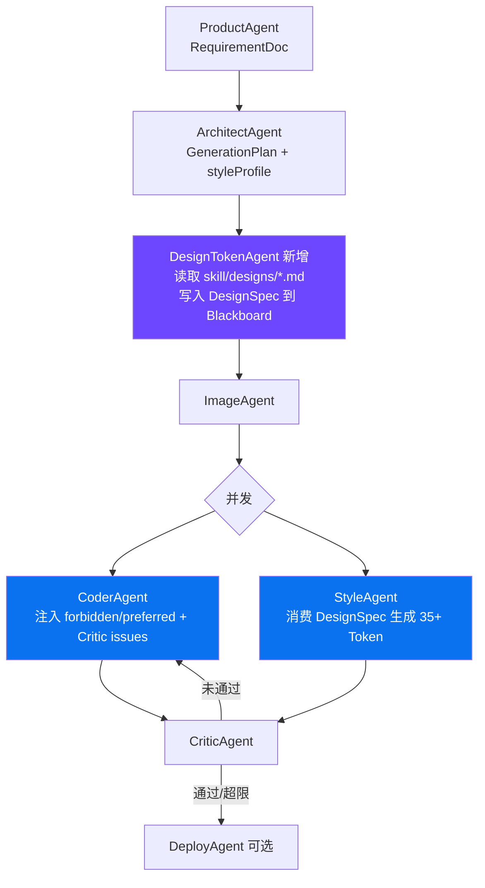

# 设计规范知识库 + DesignTokenAgent 改造计划

> 版本：v1.0 | 日期：2026-06-17 | 项目：CreatAi / YuAiFather

---

## 一、产品概述

对当前多 Agent Vue 项目生成流水线进行升级，引入「品牌级设计规范知识库 + DesignTokenAgent」，从源头消除生成页面的「AI 味道」（千篇一律的毛玻璃、装饰渐变、硬编码字号 / 间距 / 圆角等）。同时顺手修复 CriticLoop 修复轮次中 CoderAgent 拿不到问题清单导致盲目重试的隐患。

## 二、核心功能

- **行业风格识别**：ArchitectAgent 在生成 GenerationPlan 时新增 `styleProfile` 字段（startup / enterprise / ecommerce / portfolio / dashboard / landing），从需求中识别行业标签。
- **设计规范知识库**：在 `resources/skill/designs/` 下提供 6 份行业 DESIGN.md，包含字号 / 间距 / 圆角 / 阴影 Token 体系和「禁用模式 / 推荐写法」清单。
- **DesignTokenAgent（新 Worker）**：不调用 LLM，纯 Java 读取 Markdown + 解析，根据 styleProfile 加载对应规范写入 Blackboard，失败时降级使用默认规范、不中断流水线。
- **StyleAgent 升级**：消费 DesignSpec 全文，把 variables.css 从 ~15 个变量扩展到 ~35 个完整 Design Token（7 级字号 + 间距刻度 + 行高 + 字间距 + 圆角 + 阴影）。
- **CoderAgent 升级**：buildUserMessage 注入两段强约束——设计禁用 / 推荐清单 + 上一轮 Critic 问题清单，使生成与修复都有明确依据。
- **流水线插入新节点**：Architect → DesignToken → Image → [Coder ‖ Style] → Critic。

## 三、技术栈

沿用项目当前栈：Java 17 + Spring Boot + LangChain4j + Reactor（Flux）+ Hutool + Jackson。新增内容全部为纯 Java 类与 Markdown 资源，不引入新依赖。

## 四、实现策略

1. **零 LLM 设计规范加载**：DesignTokenAgent 通过 classpath 读取 `skill/designs/{profile}.md`，使用 Jackson 友好的简单正则解析 `## Forbidden Patterns` / `## Preferred Patterns` 列表项与 Token 表格，延迟 < 10ms。
2. **强约束注入而非建议**：CoderAgent 在 userMessage 末尾以「## 强制设计规范（违反视为严重错误）」标题硬注入禁用清单，相比仅写在 system prompt 更不易被 LLM 忽略。
3. **修复轮次有据可依**：复用已有 CriticReport 结构，CoderAgent 在 buildUserMessage 时若检测到 `criticReport != null && !passed` 则把 issues 注入 prompt，根除「盲目重试」。
4. **降级策略**：DesignTokenAgent 失败仅 `sink.complete()` + 推 status 事件，绝不 `sink.error()`，保证后续 Image / Coder / Style 仍能运行。
5. **复用现有模式**：新 Worker 继承现有 `Agent` 接口、使用 `subscribeOn(Schedulers.boundedElastic())`、通过 `AgentEvent.status()` 推事件，与 ArchitectAgent / StyleAgent 完全一致。

## 五、性能与可靠性

- DesignTokenAgent 不增加 LLM token 消耗，单次解析 O(n) 文本（n ≈ 单文件 5-10KB）。
- DesignSpec 在 Blackboard 中以引用形式共享，CoderAgent / StyleAgent 仅读取，无并发写入冲突（ConcurrentHashMap 已保证）。
- forbidden / preferred 列表注入 prompt 后，CoderAgent token 增量约 200-400 tokens，可控。

## 六、架构设计



## 七、实现要点

- **文件读取安全**：仅从 classpath 读取固定白名单文件名（PROFILE_MAP 枚举），无用户输入拼接路径，无路径穿越风险。
- **日志规范**：沿用 `@Slf4j` + `log.info/warn/error("xxx appId={} ...", ctx.getAppId(), ...)` 格式，不输出 DesignSpec 全文，仅输出 sourceMd 路径与 forbidden 数量。
- **向后兼容**：styleProfile 为新增可选字段；旧的 GenerationPlan JSON 反序列化不受影响；DesignTokenAgent 降级时 Blackboard 中无 DesignSpec，CoderAgent / StyleAgent 已做 null 判断。

## 八、目录结构

```
src/main/java/com/yu/yuaifather/
├── agent/
│   ├── core/
│   │   └── Blackboard.java                # [MODIFY] 新增 putDesignSpec/getDesignSpec 方法及 KEY_DESIGN_SPEC 常量
│   ├── orchestrator/
│   │   └── OrchestratorAgent.java         # [MODIFY] 构造函数注入 DesignTokenAgent；流水线在 architect 之后 image 之前 concatWith(designTokenAgent.handle(ctx))
│   ├── support/
│   │   └── DesignProfileResolver.java     # [NEW] 纯 Java 工具类。维护 styleProfile→classpath 路径映射；从 Markdown 解析 forbidden/preferred 列表与 Token 表格；构建 DesignSpec
│   └── workers/
│       ├── DesignTokenAgent.java          # [NEW] 新 Worker。读取 plan.styleProfile，调用 DesignProfileResolver 加载 DesignSpec 并写入 Blackboard；不调用 LLM；失败降级 sink.complete()
│       ├── StyleAgent.java                # [MODIFY] 从 Blackboard 读取 DesignSpec，将 fullContent 加入 LLM 输入，让 LLM 按规范产出 35+ 变量
│       └── CoderAgent.java                # [MODIFY] buildUserMessage 末尾追加：① DesignSpec.forbiddenPatterns + preferredPatterns；② 若存在未通过 CriticReport 则注入 issues 清单
├── ai/model/dto/
│   ├── DesignSpec.java                    # [NEW] DTO。字段：styleProfile, sourceMd, fullContent, forbiddenPatterns(List), preferredPatterns(List), extraTokens(Map)；@Data @Builder @NoArgsConstructor @AllArgsConstructor
│   └── GenerationPlan.java                # [MODIFY] 新增 String styleProfile 字段及 javadoc，列出取值枚举

src/main/resources/
├── prompt/
│   ├── agent-architect-system-prompt.txt  # [MODIFY] 输出契约 JSON 加入 styleProfile 字段；补充取值规则段落（行业→profile 映射、默认 startup）
│   └── agent-style-system-prompt.txt      # [MODIFY] 扩展 variables.css 模板至 35+ Token（含 --font-xs..--font-3xl、--leading-*、--tracking-*、完整 --space-* 刻度）；新增「所有样式值必须使用变量」硬约束
└── skill/designs/                         # [NEW] 设计规范知识库目录
    ├── startup.md                         # [NEW] Linear/Vercel 风格：负字距 -0.02em、极简黑白、禁装饰渐变、禁毛玻璃
    ├── enterprise.md                      # [NEW] Ant Design/Material 风格：宽松间距、中性色、专业克制、阴影克制
    ├── ecommerce.md                       # [NEW] Shopify 风格：密集卡片、促销色、圆角偏大、CTA 突出
    ├── portfolio.md                       # [NEW] Framer 风格：大字号、宽留白、单色主调、艺术感
    ├── dashboard.md                       # [NEW] Supabase/IBM 风格：紧凑间距、数据优先、低饱和、表格 friendly
    └── landing.md                         # [NEW] 转化导向：大 Hero、有节制渐变、CTA 强对比
```

每个 designs/*.md 统一结构：`# Title` / `## Typography` 表格 / `## Spacing` 表格 / `## Radii` 表格 / `## Shadows` 表格 / `## Forbidden Patterns` 列表 / `## Preferred Patterns` 列表。Resolver 按这 6 个固定二级标题解析。

## 九、关键接口

```java
// DesignSpec：仅定义形状，不含实现
public class DesignSpec {
    private String styleProfile;
    private String sourceMd;
    private String fullContent;
    private List<String> forbiddenPatterns;
    private List<String> preferredPatterns;
    private Map<String, String> extraTokens;
}

// DesignProfileResolver：核心方法签名
public DesignSpec resolve(String styleProfile);

// Blackboard：新增方法签名
public void putDesignSpec(DesignSpec spec);
public DesignSpec getDesignSpec();
```

## 十、Agent Extensions

### Skill

- **Google-Gemini-Design-Md**
- Purpose：作为编写 6 份 `skill/designs/*.md` 行业规范文件的内容参考来源，借鉴其 186+ 风格提示词与 66 个世界级品牌（Linear、Vercel、Shopify、Framer、Supabase 等）的 Token 体系与禁用模式清单。
- Expected outcome：6 份规范文件内容来源权威、Token 命名一致、禁用清单覆盖典型 AI 味道模式（毛玻璃、装饰渐变、硬编码 px、scale hover 等），保证 DesignTokenAgent 解析后的约束足以让 LLM 产出非千篇一律的视觉。
