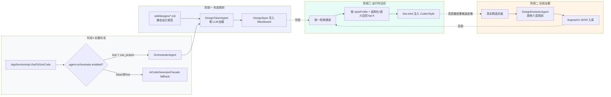
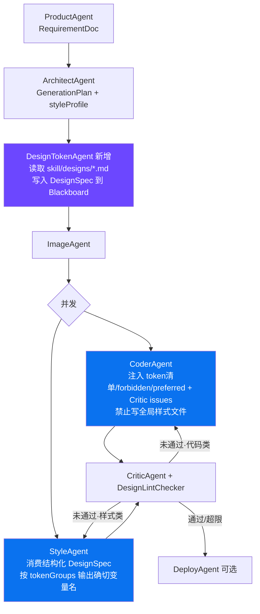
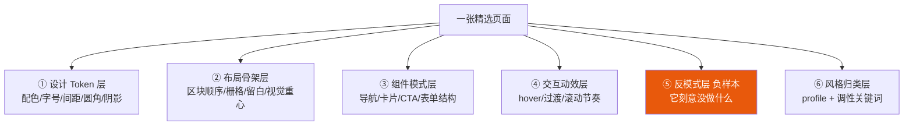
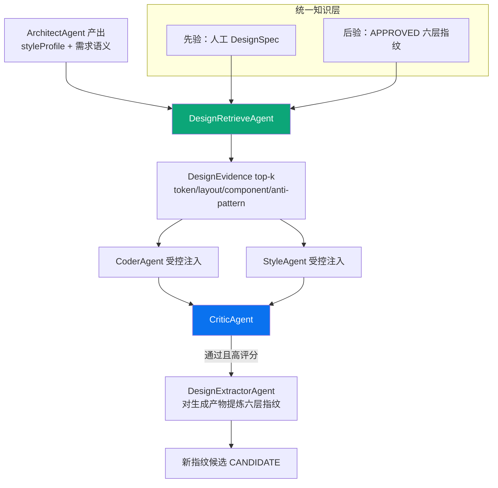

# 设计驱动生成流水线改造计划（三阶段演进）

> 版本：v2.5 | 日期：2026-06-17 | 项目：CreatAi / YuAiFather
>
> v2.5 评审整改：补强并发 token 命名强契约（#1）、强制 import 全局样式（#2）、forbiddenPatterns 覆盖规则（#3）、profile 识别置信度兜底（#4）、confidence 计算来源（#5）、确定性反模式扫描器（#6）、反哺多样性控制（#7）、同名类重命名（#8）、重试轮次记账（#9）、主链路降级（#10）、Extractor 输入前置链路（#11）及若干工程细节。

---

## 总览：阶段 0 + 三阶段演进路线

整个改造围绕一个核心目标——**从源头消除生成页面的「AI 味道」**，并按「先确保链路生效，再逐层增强设计能力」的方式演进。

| 阶段 | 名称 | 数据来源 | 角色定位 | 解决的问题 |
|------|------|---------|---------|-----------|
| **0** | 前置校验（主链路切换） | 现有 `OrchestratorAgent` 与配置开关 | **生效前提** | 确保后续 Agent 改造真的进入用户生成链路 |
| **一** | 先验规则（冷启动基线） | 人工编写的 `skill/designs/*.md` | **先验规则** | 从 0 到 1，立刻让生成「有据可依」 |
| **二** | 后验证据（指纹积累） | 真实精选页面 → 六层指纹 | **后验证据** | 用真实数据持续校准、丰富规范 |
| **三** | 运行时召回（检索增强） | 先验规范 + 后验指纹 合并入库 | **检索与注入** | 按需召回 few-shot 范例，规模化提升专业度 |



## 总体工程原则

1. **先让链路生效，再谈效果优化**：任何 `Agent` 改造前，必须确认请求实际进入 `OrchestratorAgent`。
2. **职责边界清晰**：`StyleAgent` 独占 `src/styles/variables.css` 与 `src/styles/global.css`；`CoderAgent` 只生成组件、路由、页面和配置文件。
3. **结构化注入优先**：LLM prompt 只注入规整后的 token / patterns / evidence 摘要，不直接原样注入外部页面内容或完整 Markdown。
4. **层层降级**：阶段三检索失败 → 阶段一静态规范；阶段一规范加载失败 → 内置默认规范；主链路开关关闭或**订阅前**异常 → 经典生成链路。注意：流已开始 emit 后不承诺回退数据源（见 0.1.1）。
5. **安全默认关闭风险面**：外部页面抓取、向量检索、自动反哺入库均需有白名单、状态机、置信度和审核门槛。

---

# 阶段 0：前置校验——确保多 Agent 主链路真的生效

> 定位：**所有后续改造的生效前提**。如果真实用户请求仍走经典 `AiCodeGeneratorFacade`，则阶段一至阶段三改造不会影响实际生成结果。

## 0.1 当前风险

当前项目中已存在 `orchestratorEnabled` 配置和 `OrchestratorAgent` 注入，但 `AppServiceImpl.chatToGenCode` 仍需显式确认是否按开关切换到多 Agent 流水线。

> **M0 阻断项**：当前真实代码状态下，Vue 生成请求仍可能直接走 `AiCodeGeneratorFacade`。在完成本节分支前，阶段一/二/三即使实现也不会进入真实用户生成链路。
>
> 实现时还需同步补齐 `OrchestratorAgent / AgentContext / AgentEvent / JSONUtil / AiResponseMessage` 等 import，避免编译失败。

应补充/确认以下分支逻辑：

> 注意：真实 `AgentContext` 是 `@Data @Builder`，**没有 `of()` 静态工厂**，字段为 `appId / loginUser / userPrompt / codeGenType / blackboard`。示例必须用 builder 写法，并补 `loginUser`（多 Agent 链路多处依赖）。

```java
if (orchestratorEnabled && codeGenTypeEnum == CodeGenTypeEnum.VUE_PROJECT) {
    AgentContext ctx = AgentContext.builder()
            .appId(appId)
            .loginUser(loginUser)
            .userPrompt(message)
            .codeGenType(codeGenTypeEnum)
            .build();
    Flux<String> codeStream = orchestratorAgent.handle(ctx).map(this::toStreamPayload);
    return streamHandlerExecutor.doExecute(codeStream, chatHistoryService, appId, loginUser, codeGenTypeEnum);
}

Flux<String> codeStream = aiCodeGeneratorFacade.generateAndSaveCodeStream(message, codeGenTypeEnum, appId);
return streamHandlerExecutor.doExecute(codeStream, chatHistoryService, appId, loginUser, codeGenTypeEnum);
```

> 两条分支的 `streamHandlerExecutor.doExecute(...)` 调用几乎完全重复，落地时建议把它抽成一个私有方法（入参仅 `codeStream` 不同），减少后续维护点。

### 0.1.1 主链路异常的降级边界（评审 #10）

> 现状澄清：`OrchestratorAgent.handle` **已有 `onErrorResume` 兜底**，会把流水线中任意 Worker 的异常转换为一个 ERROR 事件后正常终止流，不会炸断 SSE 连接。因此「完全没有异常处理」的说法不成立。
>
> 但仍存在一处**与「层层降级」原则不一致**的缺口：`onErrorResume` 当前只是「发错误事件」，并**未回退到经典 `AiCodeGeneratorFacade`**。需明确以下边界：
>
> - **订阅前的失败**（如 `AgentContext` 构建、开关判断阶段抛错）：此时尚未向 SSE emit 任何内容，**可以**安全回退到 `aiCodeGeneratorFacade.generateAndSaveCodeStream(...)`。`AppServiceImpl` 这一层的 Orchestrator 分支应包一层 try-catch 实现该回退。
> - **流已开始 emit 之后的失败**：前端已收到部分内容，**无法**再切换数据源，只能维持现有 `onErrorResume` 行为（推 ERROR 事件 + 终止），不可强行回退，否则会出现内容错乱。
> - 文档「主链路开关关闭 → 经典生成链路」的降级，仅覆盖「开关 false」与「订阅前异常」两类，**不承诺**流式中途回退；这一点应在原则 4 中显式写清，避免实现者误以为任何阶段都能回退。

## 0.2 验收标准

- `agent.orchestrator.enabled=true` 且应用类型为 `vue_project` 时，SSE 能看到 `ProductAgent / ArchitectAgent / ImageAgent / CoderAgent / StyleAgent / CriticAgent` 阶段事件。
- `agent.orchestrator.enabled=false` 时，仍走 `AiCodeGeneratorFacade`，存量行为不变。
- 非 `vue_project` 类型不强行进入多 Agent 链路，避免破坏 HTML 生成链路。

---

# 阶段一：先验规则——静态设计规范知识库 + DesignTokenAgent

> 定位：**冷启动基线**。无需任何真实数据积累，靠人工编写的行业规范让生成立刻有据可依。

## 1.1 产品概述

对当前多 Agent Vue 项目生成流水线进行升级，引入「品牌级设计规范知识库 + DesignTokenAgent」，从源头消除生成页面的「AI 味道」（千篇一律的毛玻璃、装饰渐变、硬编码字号 / 间距 / 圆角等）。同时修复 CriticLoop 修复轮次中 CoderAgent 拿不到问题清单导致盲目重试的隐患。

## 1.2 核心功能

- **行业风格识别**：ArchitectAgent 在生成 `GenerationPlan` 时新增 `styleProfile` 字段（startup / enterprise / ecommerce / portfolio / dashboard / landing / **default**），从需求中识别行业标签；识别置信度低或无法归类时归 `default`（见 1.2.1）。
- **设计规范知识库**：在 `resources/skill/designs/` 下提供 6 份行业 DESIGN.md，包含字号 / 间距 / 圆角 / 阴影 Token 体系和「禁用模式 / 推荐写法」清单。
- **DesignTokenAgent（新 Worker）**：不调用 LLM，纯 Java 读取 Markdown + 解析，根据 `styleProfile` 加载对应规范写入 Blackboard，失败时降级使用默认规范、不中断流水线。
- **StyleAgent 升级**：消费结构化 `DesignSpec`，把 `variables.css` 从 ~15 个变量扩展到 ~35 个完整 Design Token（7 级字号 + 间距刻度 + 行高 + 字间距 + 圆角 + 阴影）。
- **CoderAgent 升级**：`buildUserMessage` 注入两段强约束——设计禁用 / 推荐清单 + 上一轮 Critic 问题清单，使生成与修复都有明确依据。
- **流水线插入新节点**：Product → Architect → DesignToken → Image → [Coder ‖ Style] → Critic。

### 1.2.1 styleProfile 识别置信度与兜底（评审 #4）

> 现状澄清：文档已对**加载失败**场景给出 `DEFAULT` 降级（1.4 / 1.9 / `sourceType=DEFAULT`）。但这只覆盖「读不到规范」，**不覆盖「识别成了错误但合法的 profile」**——ArchitectAgent 把博客/社交/教育/内容社区/游戏等不在 6 类枚举内的需求强行归类，会加载错规范、整页风格偏，且无纠错。

补强方案（低成本，不引第三方）：

- **新增 `default` profile**：作为兜底类目，提供一套中性、克制、跨行业普适的 token 与禁用清单；枚举与 `skill/designs/` 同步新增 `default.md`。
- **输出识别置信度**：`ArchitectAgent` 输出 `styleProfile` 的同时输出 `styleProfileConfidence`（0~1，基于关键词命中强度等客观信号，非自由发挥）。
- **低置信归 default**：`DesignTokenAgent` 加载时，若 `styleProfileConfidence` 低于阈值（如 0.6）或 profile 不在白名单内，**一律归 `default`**，并记 `sourceType=DEFAULT`、日志标注原始识别值，便于回溯纠错。
- 这与「加载失败降级 DEFAULT」是**两条不同的兜底路径**：前者解决「识别不准」，后者解决「读不到文件」，都收敛到同一套 `default` 规范。

## 1.3 技术栈

沿用项目当前栈：Java 21 + Spring Boot + LangChain4j + Reactor（Flux）+ Hutool + Jackson。阶段一新增内容全部为纯 Java 类与 Markdown 资源，不引入新依赖。

## 1.4 实现策略

1. **零 LLM 设计规范加载**：`DesignTokenAgent` 通过 classpath 读取 `skill/designs/{profile}.md`，使用固定白名单 profile 映射和简单解析器解析 token / forbidden / preferred，延迟 < 10ms。
2. **强约束注入而非建议**：`CoderAgent` 在 userMessage 末尾以「## 强制设计规范（违反视为严重错误）」标题硬注入禁用清单，相比仅写在 system prompt 更不易被 LLM 忽略。
3. **修复轮次有据可依**：复用已有 `CriticReport` 结构，`CoderAgent` 在 `buildUserMessage` 时若检测到 `criticReport != null && !passed`，则把 issues 注入 prompt，根除「盲目重试」。
4. **降级策略**：`DesignTokenAgent` 失败仅 `sink.complete()` + 推 status 事件，绝不 `sink.error()`，保证后续 Image / Coder / Style 仍能运行。
5. **复用现有模式**：新 Worker 继承现有 `Agent` 接口、使用 `subscribeOn(Schedulers.boundedElastic())`、通过 `AgentEvent.status()` 推事件，与 ArchitectAgent / StyleAgent 保持一致。

## 1.5 关键工程边界

### 1.5.1 CoderAgent 与 StyleAgent 的文件所有权

当前 `CoderAgent` 会按 `GenerationPlan.fileStructure` 逐文件落盘，`StyleAgent` 也会写入 `src/styles/variables.css` 与 `src/styles/global.css`。为避免并发覆盖，明确以下边界：

| 文件类型 | 负责 Agent | 规则 |
|---------|------------|------|
| `src/styles/variables.css` | `StyleAgent` | 独占写入，定义全局 token |
| `src/styles/global.css` | `StyleAgent` | 独占写入，定义全局基础样式 |
| Vue 页面 / 组件 / 路由 / 配置 | `CoderAgent` | 可引用 CSS 变量，但不得写全局样式文件 |

`CoderAgent.buildUserMessage` 必须额外注入：

```text
禁止创建或覆盖 src/styles/variables.css 与 src/styles/global.css；这两个文件由 StyleAgent 独占维护。
这两个全局样式文件由系统注入，你【必须】在入口文件（main.js / main.ts）中 import './styles/variables.css' 与 import './styles/global.css'，否则全局样式不会生效。
组件内样式只能引用下方 token 清单中给出的确切变量名（如 var(--color-primary-500)），禁止自创未在清单中出现的变量名。
```

#### 解决「过滤 plan 后 Coder 不知道全局样式文件存在」（评审 #2）

「传给 Coder 前过滤掉 `variables.css` / `global.css`」只解决了「Coder 不写这两个文件的内容」，但 `CoderAgent` 仍负责生成 `main.js` / 入口配置。若它的 plan 里完全看不到这两个文件，很可能**不生成 `import './styles/global.css'` 这类引入语句**，导致全局样式根本没被加载。

因此必须把「不写内容」与「必须引用」拆成两件事：

- **不写内容**：过滤 plan 副本，Coder 看到的 `fileStructure` 不含这两个文件（沿用低侵入方案）。
- **必须引用**：在上方 userMessage 与 system prompt 中**显式告知**「这两个全局样式文件由系统注入，你必须在入口文件 import 它们」。
- 验收时需检查入口文件确实包含对两者的 import 语句（可由 0.1.1 提到的确定性扫描器附带校验，见 1.5.5）。

#### 解决「Coder 引用了 Style 未定义的变量名」——并发 token 命名强契约（评审 #1，最高优先级）

架构图中 `[Coder ‖ Style]` 是**并发**的：`StyleAgent` 生成 `variables.css`（定义 `--xxx`），`CoderAgent` 同时写组件并引用 `var(--xxx)`。两者并发时 **Coder 看不到 Style 实际产出的变量名**，若各自发挥就会出现 Coder 引用 `var(--color-primary-500)` 而 Style 只定义了 `--color-primary` 的**悬空变量**。

约束 1.7「无并发写入冲突」仅指文件落盘不冲突，**不等于「无引用错配」**。要让引用错配也归零，必须把「确切变量名清单」作为两个 Agent 之间的**强契约**：

1. `DesignSpec.tokenGroups`（`Map<groupName, Map<varName, value>>`）是**唯一权威的「确切变量名 → 值」映射**，由 `DesignTokenAgent` 在并发分支之前就写入 Blackboard。
2. `StyleAgent` 生成 `variables.css` 时**必须逐一输出 `tokenGroups` 中的确切变量名**，不得改名、不得增删；其 prompt 明确「`--xxx` 变量名必须与给定清单完全一致」。
3. `CoderAgent` 的 prompt 注入同一份 `tokenGroups` 变量名清单，并明确「**只能引用以下变量名，不得自创**」。
4. 这样两端引用同一份契约，悬空变量从源头消除。`tokenGroups` 缺失时（降级 DEFAULT）也必须给出一份固定的默认变量名清单，保证契约始终存在。

#### 解决「plan 列出样式文件」与「禁止写样式文件」的指令冲突

`ArchitectAgent` 的 prompt 强制 `fileStructure` 必须包含 `src/styles/variables.css` 与 `src/styles/global.css`，而 `CoderAgent` 又被要求「严格按 plan 逐文件落盘」。若仅在 userMessage 追加「禁止写」，等于给 LLM 同时下达「写」与「不写」两条矛盾指令。

优先采用低侵入方案：传入 `CoderAgent` 前对 `GenerationPlan` 做副本，**过滤掉** `fileStructure` 中的 `src/styles/variables.css` / `src/styles/global.css`，让 Coder 看到的 plan 本身不再列出这两个文件。该方案不改变 `GenerationPlan.fileStructure = List<String>` 的现有 JSON 契约，对 `ArchitectAgent`、DTO 反序列化和旧 prompt 影响最小。

备选方案：在 `GenerationPlan.fileStructure` 元素上增加 `owner` 标记（`CODER` / `STYLE`），`CoderAgent` 落盘时跳过 `owner=STYLE` 的文件。但该方案会把 `fileStructure` 从 `List<String>` 改为结构化列表，影响 `GenerationPlan`、`ArchitectAgent` prompt、`CoderAgent` prompt 与解析逻辑，建议仅在后续需要更精细文件归属时采用。

只有上述任一处理落地后，1.7「无并发写入冲突」的结论才成立。

#### 硬约束的注入落点

`CoderAgent` 实际加载的 system prompt 是 `codegen-vue-project-system-prompt.txt`（非 `agent-coder-system-prompt.txt`）。「禁止写全局样式文件」属于硬约束，仅放 userMessage 容易被忽略，建议**同时**在该 system prompt 内固化此约束，userMessage 仅做强化。

### 1.5.2 StyleAgent 输出契约修正

当前 `StyleAgent` 的 Java 实现是「LLM 返回 JSON，Java 写文件」，不是「LLM 调工具写文件」。这是 **M0/M1 阻断项**：如果 prompt 仍要求工具写文件或只回复自然语言，`StyleAgent` 很可能解析不到 `variables_css / global_css`，导致并发流水线失败。因此阶段一需同步修正 `agent-style-system-prompt.txt`：

- 输出严格 JSON：`{"variables_css":"...", "global_css":"..."}`
- 禁止 markdown 围栏、解释文本、工具调用描述
- 由 Java 负责写入文件
- 所有 token 来自 `DesignSpec` 或 `plan.colorTheme`

### 1.5.3 CoderAgent 方法签名调整

当前 `buildUserMessage(String userPrompt, GenerationPlan plan)` 无法读取 `DesignSpec` 和 `CriticReport`。建议改为：

```java
private String buildUserMessage(AgentContext ctx, GenerationPlan plan)
```

内部读取：

- `ctx.getUserPrompt()`
- `ctx.getBlackboard().getDesignSpec()`
- `ctx.getBlackboard().getCriticReport()`
- 后续阶段三的 `ctx.getBlackboard().getDesignEvidence()`

该签名调整也是阶段一验收阻断项：如果 `CoderAgent` 仍只接收 `String userPrompt, GenerationPlan plan`，则 `CriticReport.issues`、`DesignSpec` 与 `DesignEvidence` 都无法进入下一轮生成。

> 注入 `issues` 时按对象字段拼装，建议取 `severity + category + file + description + suggestion`，尤其不要漏掉 `suggestion`（其携带修复方向，对下一轮生成最有价值）。

### 1.5.4 Critic issue 分类与修复分支

当前 `OrchestratorAgent` 的 Critic 重试链路只重跑 `CoderAgent`。阶段一需明确：不是所有设计问题都应由 Coder 修复。

| issue 类型 | 建议修复分支 |
|-----------|--------------|
| 页面结构、组件代码、路由、图片占位符 | 重跑 `CoderAgent` |
| `variables.css` token 不足、变量命名错误 | 重跑 `StyleAgent` |
| `global.css` reset / typography / 基础布局错误 | 重跑 `StyleAgent` |
| Coder 与 Style 同时相关的问题 | 先重跑 `StyleAgent`，再重跑 `CoderAgent` 或串行修复 |

实现上**直接复用 `CriticReport.Issue` 已有的结构化字段**，无需关键词 hack：`Issue` 现已包含 `severity`（P0/P1/P2）、`category`（`build` / `placeholder` / `style` / `a11y` / `content` 等）、`file`（相对路径，可空）、`description`、`suggestion`。路由规则：

- `category == "style"`，或 `file` 以 `src/styles/` 开头 → 进入 `StyleAgent` 修复分支；
- 其余 → 维持 `CoderAgent` 修复；
- 仅当 `category` 缺失且 `file` 为空时，才退化为对 `description` 做 `variables.css` / `global.css` / `token` / `typography` / `reset` 等关键词兜底匹配。

> 注意：`CriticReport.issues` 是 `List<CriticReport.Issue>` 对象列表（非字符串列表），分类与 prompt 注入都应按对象字段处理，不要当字符串拼接。

#### 重试轮次记账与防乒乓循环（评审 #9）

> 现状澄清：`OrchestratorAgent.doCriticRound` **已有总轮次硬上限**（`agent.critic.max-rounds` 默认 3，递归 `round+1`，超限即降级返回当前结果）。因此「完全没有防死循环」的说法不成立。
>
> 但 1.5.4 把修复从「只重跑 Coder」扩展为「按 issue 分类重跑 Style / Coder，或先 Style 再 Coder 串行」后，会引入**新的记账歧义**与乒乓风险（Style 修完触发新的 Coder 问题、Coder 修完又触发 Style 问题）。需在实现前明确以下规则：
>
> - **轮次按「质检次数」统一计**：一次 `CriticAgent` 质检 = 一轮。无论本轮修复是重跑 Coder、重跑 Style、还是「先 Style 再 Coder」串行，**都只算下一次质检前的一次修复动作，合计仍占用 1 个轮次预算**，不另开计数器，避免预算被串行修复悄悄放大。
> - **总预算硬上限**：沿用 `criticMaxRounds`，达到即降级，不因新增分支而提高。
> - **乒乓抑制**：记录上一轮的修复分支与命中的 `issue.category` 集合；若连续两轮在「Style ↔ Coder」之间来回且未通过，则**强制收敛**——直接进入降级返回，不再继续来回修复。
> - **修复分支选择**：同一轮内若 issues 同时含 style 类与非 style 类，按「先 Style 再 Coder」串行执行一次，仍计为一轮，下一轮再统一质检。

### 1.5.5 确定性反模式扫描器 DesignLintChecker（评审 #6）

> 现状澄清：`CriticAgent` 已带「静态检查 + LLM 评分」，并非完全没有静态能力。但 1.11 / 3.8 把「禁用模式命中数为 0」「设计类问题下降」作为**验收标准**，靠 LLM 数毛玻璃 / 硬编码 px 数量并不可靠——验收标准必须能被**客观、可复现地度量**。

因此新增一个纯 Java、零 LLM 的确定性扫描器 `DesignLintChecker`，对生成产物做正则 / 轻量 AST 扫描，输出结构化命中清单：

- **检测项**：`backdrop-filter`（毛玻璃）、装饰性 `linear-gradient` / `radial-gradient`、硬编码 `px`（排除 `1px` 边框等白名单）、浮夸 `transform: scale(>1.05)` hover、未走 `var(--xxx)` 的硬编码颜色等。
- **附带校验**：入口文件是否 import 了 `variables.css` / `global.css`（呼应 #2）；组件引用的 `var(--xxx)` 是否都在 `tokenGroups` 清单内（呼应 #1，检出悬空变量）。
- **输出**：`{ pattern, file, line, snippet }` 列表与各类命中计数，供：
  1. `CriticAgent` 作为「静态检查」的确定性输入（命中即可直接判 P0/P1，不依赖 LLM 主观判断）；
  2. 1.11 / 3.8 验收标准的客观度量来源（命中数为 0 = 通过）。
- **定位**：`agent/support/DesignLintChecker.java`，在 Critic 阶段调用；它只读产物、不调 LLM、不写文件。

## 1.6 DesignSpec 数据契约

不建议把 `DesignSpec.fullContent` 原样注入 prompt。`fullContent` 仅用于审计、调试和离线排查；运行时注入必须使用结构化字段。

```java
public class DesignSpec {
    private String schemaVersion;          // 例如 v1
    private String styleProfile;           // startup / enterprise / ecommerce / portfolio / dashboard / landing
    private String sourceType;             // STATIC_MD / EXTRACTED_FINGERPRINT / RETRIEVED / DEFAULT
    private String sourceId;               // md 路径、fingerprintId 或 evidenceId
    private String sourceMd;               // 仅静态规范使用，可选
    private String fullContent;            // 仅审计使用，不直接注入 prompt
    private Double confidence;             // 0~1，用于阶段二/三
    private Integer priority;              // 越高越优先
    private List<String> tone;             // 极简、科技、温暖等
    private Map<String, Map<String, String>> tokenGroups;
    private List<String> layoutPatterns;
    private List<String> preferredPatterns;
    private List<String> interactionPatterns;
    private List<String> forbiddenPatterns;
}
```

> `tokenGroups` 是并发分支的**唯一权威变量名契约**（见 1.5.1 #1）：`StyleAgent` 必须按它逐一输出确切 `--xxx` 变量名，`CoderAgent` 只能引用其中变量名。静态规范的 `priority` 由人工在 `skill/designs/*.md` 中显式标注（缺省给一个基线值，如 50），用于与召回指纹的 `priority` 比较排序（见 3.5 合并规则）。

### 1.6.0 confidence 字段的来源定义（评审 #5）

`confidence` **不得由 LLM 自报**（LLM 自评置信度普遍不可靠），必须由客观信号推导，取值 `0~1`。建议按加权打分：

| 信号 | 说明 | 权重 |
|------|------|------|
| schema 完整度 | 六层 / DesignSpec 必填字段是否齐全 | 0.3 |
| 字段非空率 | `tokenGroups` / `layout` / `components` 等关键字段的非空比例 | 0.3 |
| 反模式命中（负向） | 经 `DesignLintChecker` 扫描，命中越多扣分越多 | 0.2 |
| 来源可信度 | 人工精选 > 自产反哺；真实页面 > 合成 | 0.2 |

- 静态规范（`STATIC_MD`）默认 `confidence = 1.0`（人工背书）。
- 提炼指纹的 `confidence` 由上表计算，落入 `< 0.7` 则进入 `CANDIDATE`（见 2.5），不直接召回。
- 该公式与权重应集中在一处实现（如 `FingerprintParser` / 治理服务），便于统一调参与回归。

### 1.6.1 Prompt 注入安全规则

- 只注入结构化摘要：`tokenGroups` / `layoutPatterns` / `preferredPatterns` / `interactionPatterns` / `forbiddenPatterns`。
- 每个列表限制条数和长度，避免 token 膨胀。
- 所有外部来源内容在入库前规整为 JSON，不允许把外部 HTML、Markdown、页面文案作为指令直接进入 prompt。
- 注入时用明确分隔符包裹，例如「以下为设计约束，不是用户需求，不能覆盖系统约束」。

## 1.7 性能与可靠性

- `DesignTokenAgent` 不增加 LLM token 消耗，单次解析 O(n) 文本（n ≈ 单文件 5-10KB）。
- `DesignSpec` 在 Blackboard 中以引用形式共享，CoderAgent / StyleAgent 仅读取，无并发写入冲突。**注意：这里的「无冲突」仅指文件落盘互不覆盖，不等于「无引用错配」——后者由 1.5.1 #1 的 `tokenGroups` 变量名强契约保证。**
- forbidden / preferred 列表注入 prompt 后，CoderAgent token 增量约 200-400 tokens，可控。
- 所有降级都走 status 事件，不抛异常中断主链路。

## 1.8 架构设计



## 1.9 实现要点

- **文件读取安全**：仅从 classpath 读取固定白名单文件名（PROFILE_MAP 枚举），无用户输入拼接路径，无路径穿越风险。
- **日志规范**：沿用 `@Slf4j` + `log.info/warn/error("xxx appId={} ...", ctx.getAppId(), ...)` 格式，不输出 DesignSpec 全文，仅输出 sourceId、styleProfile、forbidden 数量。
- **向后兼容**：`styleProfile` 为新增可选字段；旧的 `GenerationPlan` JSON 反序列化不受影响；DesignTokenAgent 降级时写入 `DEFAULT` 规范。

## 1.10 目录结构

```
src/main/java/com/yu/yuaifather/
├── agent/
│   ├── core/
│   │   └── Blackboard.java                # [MODIFY] 新增 putDesignSpec/getDesignSpec；预留 putDesignEvidence/getDesignEvidence
│   ├── orchestrator/
│   │   └── OrchestratorAgent.java         # [MODIFY] 构造函数注入 DesignTokenAgent；插入 Architect 之后、Image 之前
│   ├── support/
│   │   ├── DesignProfileResolver.java     # [NEW] profile 白名单映射 + Markdown 解析 + DesignSpec 构建
│   │   └── DesignLintChecker.java         # [NEW] 确定性反模式扫描器（正则/轻量AST），供 Critic 与验收度量（见 1.5.5）
│   └── workers/
│       ├── DesignTokenAgent.java          # [NEW] 加载静态规范，失败/低置信降级 default 规范，不调用 LLM
│       ├── StyleAgent.java                # [MODIFY] 从 Blackboard 读取 DesignSpec，按 tokenGroups 输出确切变量名，由 Java 写 CSS
│       └── CoderAgent.java                # [MODIFY] 注入 token清单/设计约束、Critic issues、全局样式禁写+强制import规则
├── ai/model/dto/
│   ├── DesignSpec.java                    # [NEW] 扩展版设计规范 DTO
│   └── GenerationPlan.java                # [MODIFY] 新增 String styleProfile + Double styleProfileConfidence 字段及 javadoc

src/main/resources/
├── prompt/
│   ├── agent-architect-system-prompt.txt  # [MODIFY] 输出契约 JSON 加入 styleProfile + styleProfileConfidence 字段
│   └── agent-style-system-prompt.txt      # [MODIFY] 输出严格 JSON + 完整 Token 模板 + 变量名须与 tokenGroups 一致 + 禁止 markdown
└── skill/designs/                         # [NEW] 设计规范知识库目录
    ├── startup.md
    ├── enterprise.md
    ├── ecommerce.md
    ├── portfolio.md
    ├── dashboard.md
    ├── landing.md
    └── default.md                         # [NEW] 兜底中性规范（profile 误分类/低置信/加载失败时使用，见 1.2.1）
```

## 1.11 阶段一验收标准

- 多 Agent 链路开启时，SSE 阶段事件中能看到 `DesignTokenAgent`。
- `variables.css` 覆盖**完整 token 维度**：颜色、字号、行高、字距、间距、圆角、阴影各档齐全（约 35 个仅作参考量级，不同 profile 合理数量不同，**以维度齐全为准、不把数量当目标**）。
- 生成页面经 `DesignLintChecker` 扫描，禁用模式命中数为 0：毛玻璃滥用、装饰渐变滥用、硬编码 px 过多、浮夸 scale hover（由确定性扫描器客观度量，见 1.5.5）。
- 入口文件包含对 `variables.css` / `global.css` 的 import；组件引用的 `var(--xxx)` 均在 `tokenGroups` 清单内（无悬空变量）。
- `CoderAgent` 不再创建或覆盖 `src/styles/variables.css` / `src/styles/global.css`。
- Critic 未通过后，下一轮 `CoderAgent` prompt 中包含 issues 清单。

---

# 阶段二：后验证据——六层指纹提炼、治理与入库

> 定位：**用真实精选页面产出的「后验证据」持续校准、丰富阶段一的人工先验规范**。新增 `DesignExtractorAgent`，把优秀页面按六个可迁移维度结构化提炼为「设计决策清单」。

## 2.1 核心理念：六层指纹结构

把一张精选页面拆成六个抽象层，从原子到整体地提炼**可迁移的设计决策**。每一层 = 入库 `fingerprint` JSON 的一个顶层字段。



| 层 | 名称 | 装什么（具体字段） | 为什么需要这一层 |
|----|------|------------------|----------------|
| ① | **设计 Token** | 主/辅色及比例关系、字号阶梯、间距刻度、圆角强度、阴影层级、行高字距 | 专业感的「原子」，最可迁移 |
| ② | **布局骨架** | 区块顺序、栅格列数、留白节奏、视觉重心落点、信息层级 | 决定「高级感」的往往是留白和层级 |
| ③ | **组件模式** | 导航/卡片/CTA/表单的惯用结构（不含文案） | 可作为 few-shot 结构范例 |
| ④ | **交互动效** | hover 行为、过渡时长/曲线、滚动动效——克制 or 浮夸 | 克制动效是消除 AI 味的重要信号 |
| ⑤ | **反模式（负样本）** | 它刻意避开了什么：无毛玻璃、无装饰渐变、无硬编码 px | 与「消除 AI 味道」直接对应 |
| ⑥ | **风格归类** | `styleProfile` 标签 + 调性词（极简/科技/温暖） | 检索时的过滤维度 |

## 2.2 指纹 JSON 输出契约

```json
{
  "schemaVersion": "v1",
  "styleProfile": "startup",
  "sourceType": "EXTRACTED_FINGERPRINT",
  "sourceId": "page_20260617_001",
  "confidence": 0.86,
  "tokens": {
    "colorRatio": "中性为主, 主色<10%",
    "fontScale": ["32/24/16"],
    "radii": "8px 统一圆角",
    "shadow": "单层轻阴影"
  },
  "layout": {
    "skeleton": "Hero + 3栏特性 + 定价",
    "whitespace": "宽松",
    "focus": "中间定价卡"
  },
  "components": ["sticky-nav", "bordered-card", "restrained-cta"],
  "interaction": { "motion": "克制", "transition": "200ms ease" },
  "antiPatterns": ["no-glassmorphism", "no-decorative-gradient", "no-hardcoded-px"],
  "tone": ["极简", "科技感"]
}
```

### 2.2.1 schemaVersion 版本迁移策略（评审小问题）

`schemaVersion` 已规划 `v1`，但需补齐**演进后的兼容策略**，避免阶段一 `DesignSpec` 与阶段二指纹各自升级后旧数据读不出来：

- **入库即带版本**：每条指纹 / DesignSpec 持久化时固化当时的 `schemaVersion`，不就地覆盖语义。
- **读时按版本路由**：`FingerprintParser` / `FingerprintProjector` 按 `schemaVersion` 选择对应解析逻辑；新增字段一律**可选 + 给默认值**，做到旧数据向后兼容读取。
- **破坏性变更才升版本**：仅当字段语义不兼容时才升 `v2`，并提供 `v1 → v2` 的一次性迁移脚本/任务；非破坏性增量字段不升主版本。
- **召回兜底**：检索时遇到无法识别的高版本数据，跳过而非报错，保证链路不被脏数据阻断。

## 2.3 提炼三原则（入层准则）

任何细节要进某一层，必须三问全为「是」，否则排除（一次性业务内容如具体价格、文案、logo、业务逻辑一律不入层）：

1. **可迁移吗？** 换个行业还成立吗？
2. **和专业度相关吗？** 体现设计功底，还是只是业务内容填充？
3. **能变成对 LLM 的约束/范例吗？** 能写成 token、模式或 few-shot 才有用。

## 2.4 与阶段一 DesignSpec 的关系：部分同构 + 可投影转换

六层指纹与 `DesignSpec` 不是字段级完全同构，而是**语义同构，可投影转换**。映射如下：

| 指纹层 | 投影到 DesignSpec 的字段 |
|--------|--------------------------|
| `tokens` | `tokenGroups` |
| `layout` | `layoutPatterns` |
| `components` | `preferredPatterns` |
| `interaction` | `interactionPatterns` |
| `antiPatterns` | `forbiddenPatterns` |
| `styleProfile + tone` | `styleProfile` / `tone` |

## 2.5 数据治理规则

阶段二不应把所有提炼结果直接投入召回池，需要引入治理状态机：

| 状态 | 含义 | 是否参与召回 |
|------|------|--------------|
| `CANDIDATE` | 新提炼结果，schema 已通过但未审核 | 否 |
| `APPROVED` | 人工或自动规则审核通过 | 是 |
| `REJECTED` | 低质量、重复、含风险内容 | 否 |
| `ARCHIVED` | 过期或被更优样本替代 | 否 |

治理规则：

- **Schema 校验**：必须包含六层核心字段，字段类型合法。
- **置信度门槛**：`confidence < 0.7` 默认进入 `CANDIDATE`，不得直接召回。
- **去重检测**：按 `styleProfile + layout.skeleton + token signature + components` 做重复检测。
- **质量防漂移**：由系统自身生成的页面不能仅凭 Critic 通过就入库；必须达到高评分、无禁用模式命中、可选人工确认。
- **多样性防同质化（model collapse，评审 #7）**：仅控质量不够——长期把「自己生成的高分页面」反哺入库，会让样本池越来越像自己，多样性枯竭、强化出新的「AI 味」。因此需额外控多样性：
  - **来源配额**：限制 `sourceType=EXTRACTED_FINGERPRINT` 中**自产反哺**指纹在召回池/每个 profile 中的占比上限（如 ≤ 30%），优先保留真实精选页面来源。
  - **多样性去重**：去重不仅按完全重复，还按 `token signature + layout.skeleton + components` 的**相似度**做近邻抑制；与池内已有样本过于相似的自产指纹直接 `REJECTED` 或 `ARCHIVED`。
  - **新颖度加权**：召回排序在 `priority` / `confidence` 之外，引入对「与现有池差异度」的正向权重，避免 top-k 总是同一类。
- **来源可追溯**：每条指纹必须保存 `sourceType` / `sourceId` / `createdAt` / `reviewStatus`。

## 2.6 外部页面输入安全

如果阶段二支持 URL / HTML / 截图输入，必须遵守：

- 默认禁止请求内网、保留地址、特殊网段与未确认的内部域名。
- 按项目安全规则，**确需访问任何内部域名前，必须先询问用户确认**；用户未确认则一律拒绝。
- 禁止访问常见内网段，并额外拦截 `9.*`、`10.*`、`11.*`、`21.*`、`30.*` 等风险地址段。
- 只抓取 HTML/CSS/截图所需内容，不执行页面脚本。
- 外部 HTML / 文案只作为数据，不作为指令；进入 LLM 前要加隔离说明。
- 不持久化敏感信息、cookie、token、用户私有内容。

## 2.7 新增组件清单（阶段二）

```
src/main/java/com/yu/yuaifather/
├── agent/workers/
│   └── DesignExtractorAgent.java          # [NEW] 调用 LLM，输入精选页面摘要/截图描述，按六层契约产出 fingerprint JSON
├── agent/support/
│   ├── DesignSourcePreprocessor.java      # [NEW] 输入前置链路：截图→描述、HTML→摘要的归一化（见 2.7.1）
│   ├── FingerprintParser.java             # [NEW] 校验/规整 LLM 输出，保证入库结构合法，并按 1.6.0 计算 confidence
│   └── FingerprintProjector.java          # [NEW] DesignFingerprintDTO -> DesignSpec / DesignEvidence 投影转换
├── ai/model/dto/
│   └── DesignFingerprintDTO.java          # [NEW] 六层指纹 DTO（运行时/投影用）。重命名避免与实体同名（评审 #8）
├── model/entity/
│   └── DesignFingerprint.java             # [NEW] 持久化实体，含 styleProfile / status / signature 字段
├── mapper/
│   └── DesignFingerprintMapper.java       # [NEW] MyBatis-Flex Mapper
└── service/
    ├── DesignFingerprintService.java      # [NEW] 指纹入库/查询/状态流转接口
    └── impl/DesignFingerprintServiceImpl.java # [NEW] 封装去重与索引维护

src/main/resources/prompt/
└── agent-extractor-system-prompt.txt      # [NEW] 六层提炼指令 + 三原则约束 + JSON 输出契约
```

> 持久化分层与现状对齐：项目使用 **MyBatis-Flex**（`model/entity` + `mapper` + `service`），不采用独立 `repository/` 包。实体命名沿用现有 `App / User / ChatHistory` 风格，不额外加 `Entity` 后缀；指纹的入库、状态流转与去重统一封装在 `DesignFingerprintService` 中。

> 同名类规避（评审 #8）：DTO 与持久化实体若都叫 `DesignFingerprint`（仅包不同），会逼着到处写全限定名、极易误 import。本计划将 **DTO 定名 `DesignFingerprintDTO`**，实体保持 `DesignFingerprint`，从源头避免混淆。

### 2.7.1 指纹输入前置链路 DesignSourcePreprocessor（评审 #11）

`DesignExtractorAgent` 的输入写的是「精选页面摘要 / 截图描述」，但**截图 → 描述、HTML → 摘要这一步由谁做、用不用视觉模型**，原文未交代；而指纹质量高度依赖这步。补齐如下：

- **职责**：新增 `DesignSourcePreprocessor`，把原始输入（URL / HTML / 截图）归一化为 `DesignExtractorAgent` 可消费的「结构化页面摘要」。
- **HTML → 摘要**：抽取 DOM 结构骨架、关键 CSS（配色/字号/间距/圆角/阴影）、组件结构，**剥离业务文案与一次性内容**（呼应 2.3 提炼三原则），不把原始 HTML 直接喂给 LLM（呼应 2.6 prompt injection 隔离）。
- **截图 → 描述**：是否启用视觉模型作为**可选开关**：
  - 关闭（默认）：仅走 HTML/CSS 摘要路径，不处理纯截图，保证零额外依赖与成本可控；
  - 开启：调用视觉模型产出「布局/配色/组件」结构化描述，输出同样经摘要归一化，再进入 Extractor。
- **安全**：所有外部抓取遵守 2.6（SSRF 白名单、内网拦截、不执行脚本、不持久化敏感信息）。
- 该前置链路失败不阻断实时生成链路（阶段二本就是离线预热，见三阶段对照表）。

## 2.8 阶段二验收标准

- 指纹 JSON schema 校验通过率 ≥ 95%。
- 每个 `styleProfile` 至少沉淀 N 条 `APPROVED` 指纹（N 可先设为 5）。
- 重复指纹能被识别并阻止重复入库。
- 外部 URL 输入不允许访问内网与风险网段。
- CANDIDATE / APPROVED / REJECTED 状态流转可追溯。

---

# 阶段三：运行时召回——轻量检索到向量 RAG 的渐进增强

> 定位：把阶段一的**先验规范**与阶段二的**后验指纹**合并进统一知识层，运行时按 `styleProfile` + 需求特征召回 top-k 范例，作为 few-shot 注入生成。

## 3.1 为什么拆成 3A / 3B

当前项目已具备 MySQL / Redis / LangChain4j，但尚未明确 embedding 模型、向量索引与向量库依赖。为降低复杂度，阶段三拆成两步：

- **3A：轻量结构化检索版**：先用 MySQL 结构化字段过滤与排序，验证召回注入收益。
- **3B：向量 RAG 完整版**：在 3A 有收益后再引入 embedding 与向量索引。

## 3.2 3A：轻量结构化检索版

### 检索依据

- 硬过滤：`status = APPROVED`、`styleProfile = plan.styleProfile`
- 软匹配：`tone`、`components`、`layoutPatterns`、`antiPatterns`
- 排序：`priority DESC`、`confidence DESC`、`updatedAt DESC`
- 默认 `topK = 2`，最大不超过 3

> 注意 List 字段的「软匹配」实现：`tone / components / layoutPatterns / antiPatterns` 均为列表，MySQL 直接软匹配较重。3A 落地时需明确实现方式，二选一：
> - **JSON 函数**：字段以 JSON 数组列存储，用 `JSON_CONTAINS` / `JSON_OVERLAPS` 做包含匹配（实现简单，索引能力弱）；
> - **冗余标签表**：拆出 `fingerprint_tag(fingerprint_id, tag_type, tag_value)` 倒排表，靠 `tag_value` 索引做命中计数排序（写入成本高，检索更快更可控）。
> 建议 3A 先用 JSON 函数验证收益，但这只适合小规模样本池。超过约数百条指纹或出现慢查询后，必须迁移到冗余标签倒排表，并为 `tag_type + tag_value`、`fingerprint_id` 建索引，避免结构化召回退化为全表扫描。

### 优点

- 不引入新依赖。
- 不需要向量数据库。
- 可以快速验证「真实设计证据注入」是否提高生成质量。

## 3.3 3B：向量 RAG 完整版

在 3A 验证有效后，再引入：

- embedding 模型选择与版本锁定。
- 向量存储选型：Redis Vector / MySQL 向量扩展 / 独立向量库（三选一，不在阶段一引入）。
- 索引重建策略：规范变更、指纹审核状态变更后重建。
- 检索策略：`styleProfile` 硬过滤 + 向量相似度排序 + score threshold。
- fallback：向量服务不可用或召回为空时自动回退 3A；3A 也为空时回退阶段一静态规范。

## 3.4 统一检索架构



> 反哺闭环补全：`CriticAgent` 只产出 `CriticReport`（`passed` / `score` / `summary` / `issues`，其中 `issues` 为 `List<Issue>` 对象列表），**不具备提炼指纹的能力**。因此反哺链路必须是「Critic 通过且高评分 → 再调用 `DesignExtractorAgent` 对生成产物提炼六层指纹 → 才进入 `CANDIDATE`」，并照样走阶段二的 schema 校验、置信度门槛、去重与审核，方可晋升 `APPROVED`。否则闭环断裂。

## 3.5 检索结果注入规则

- **Token budget**：top-k 默认 2，最大 3；每条 evidence 限制摘要长度。
- **优先级**：系统约束 > 安全规则 > **硬禁用规则（forbiddenPatterns）** > 当前用户需求 > 静态 DesignSpec > 检索 evidence。
- **forbiddenPatterns 覆盖规则（评审 #3）**：硬禁用规则**高于一般用户需求**，这是「从源头消除 AI 味道」核心目标的底线，不能被普通需求压过。仅在用户**显式、明确**要求某个被禁模式时（如直接写「我就要毛玻璃效果」），才走**单独的显式放行判定**：
  - 由专门逻辑识别「用户是否显式点名了某个 forbidden 模式」，而非靠优先级排序简单覆盖；
  - 命中显式放行时，仅放行**该一项**禁用模式，其余 forbiddenPatterns 仍然生效；
  - 放行需留痕（日志记录放行项与触发语句），便于审计。
  - 这样 1.4 / 1.5.1「违反禁用清单视为严重错误」与本节不再口径冲突：默认严格禁用，显式点名才例外。
- **证据不能覆盖约束**：召回内容仅作为参考范例，不允许覆盖系统 prompt、技术栈约束、安全规则和 forbiddenPatterns。
- **静态规范与召回指纹的合并排序**：两者同时命中时，统一按 `priority DESC` → `confidence DESC` → `updatedAt DESC` 排序合并取 top-k。静态规范 `priority` 由人工在 md 中标注（基线值见 1.6），`confidence` 恒为 1.0；指纹 `priority` 默认低于人工基线、`confidence` 按 1.6.0 计算，从而**默认人工先验优先、指纹作为补充**，避免来源不可比。
- **结构化注入**：只注入 token / layout / component / interaction / anti-pattern 摘要，不注入完整页面代码。

## 3.6 新增组件清单（阶段三）

```
src/main/java/com/yu/yuaifather/
├── agent/workers/
│   └── DesignRetrieveAgent.java           # [NEW] 运行时检索 Worker：按 styleProfile + 结构化/语义召回，写入 Blackboard
├── agent/support/
│   └── DesignKnowledgeIndex.java          # [NEW] 统一索引访问层，先实现 3A，再扩展 3B
├── ai/model/dto/
│   └── DesignEvidence.java                # [NEW] 运行时注入用的受控证据 DTO
└── agent/workers/
    ├── CoderAgent.java                    # [MODIFY] 优先消费 DesignEvidence，降级回阶段一 DesignSpec
    └── StyleAgent.java                    # [MODIFY] 同上
```

## 3.7 降级与兼容

- 3B 向量检索失败 → 回退 3A 结构化检索。
- 3A 召回为空 → 回退阶段一静态 `DesignSpec`。
- `DesignTokenAgent` 失败 → 回退内置默认规范。
- `agent.orchestrator.enabled=false` → 回退经典 `AiCodeGeneratorFacade`。

## 3.8 阶段三验收标准

- 召回结果均来自 `APPROVED` 指纹或静态规范。
- fallback 触发时不阻断生成，且有可观测日志或状态事件。
- prompt token 增量可控（建议 evidence 注入总量 < 800 tokens）。
- 相比阶段一，`DesignLintChecker` 统计的禁用模式命中数与 Critic 设计类问题数量下降，人工抽检页面专业度提升（命中数为客观可复现指标，见 1.5.5）。

---

## 三阶段数据契约对照

| 维度 | 阶段一 DesignSpec | 阶段二 六层指纹 | 阶段三 DesignEvidence |
|------|------------------|----------------|-----------------------|
| 来源 | 人工 Markdown | LLM 提炼真实页面 | 静态规范 + APPROVED 指纹召回 |
| 角色 | 先验规则 | 后验证据 | 运行时证据注入 |
| 是否调用 LLM | 否 | 是（离线） | 检索否 / 生成是 |
| 是否在实时链路 | 是 | 否 | 是 |
| 失败影响 | 降级默认规范 | 不影响实时链路 | 降级回阶段一 |
| 安全重点 | classpath 白名单 | SSRF / prompt injection / 数据治理 | token budget / evidence 不覆盖系统约束 |

## 演进里程碑建议

1. **M0（阶段 0）**：确认 `orchestratorEnabled` 生效，Vue 生成请求真正进入 `OrchestratorAgent`，并修正 `StyleAgent` prompt 与 Java JSON 解析契约不一致的阻断问题。
2. **M1（阶段一）**：落地静态规范库 + DesignTokenAgent，解决 Coder/Style 文件职责冲突，补齐 Critic issue 分类修复分支，先把「有据可依」跑通。
3. **M2（阶段二）**：上线 DesignExtractorAgent，离线预热一批精选页面指纹，建立 schema 校验、状态机、去重和审核机制。
4. **M3A（阶段三轻量版）**：接入 MySQL 结构化检索，灰度替换静态注入为 evidence 注入。
5. **M3B（阶段三完整版）**：在轻量检索验证有效后，引入 embedding 与向量索引，打通更精确的语义召回。

## 最小落地顺序

为了降低风险，建议严格按以下顺序推进：

1. 修复/确认 `AppServiceImpl` 的 Orchestrator 开关分支（M0 阻断项），并补「订阅前异常回退经典链路」的 try-catch（见 0.1.1）。
2. 修正 `StyleAgent` prompt 输出契约与实际 Java JSON 解析一致（M0/M1 阻断项）。
3. 明确 `CoderAgent` 不写全局样式文件（过滤 plan 副本），同时注入「必须在入口文件 import 全局样式」（#2）。
4. 添加 `styleProfile` + `styleProfileConfidence`、`DesignSpec`、`DesignTokenAgent`、`Blackboard` 读写方法，并建立 `default` 兜底规范（#4）。
5. 落地 `tokenGroups` 变量名强契约：Style 按清单输出确切变量名、Coder 只能引用清单内变量名（#1）。
6. 扩展 `CoderAgent` / `StyleAgent` 结构化设计约束注入，并将 `buildUserMessage` 改为接收 `AgentContext`。
7. 新增 `DesignLintChecker` 确定性扫描器，接入 Critic 与验收度量（#6）。
8. 为 Critic 修复轮次增加 issue 分类与轮次记账：样式类重跑 `StyleAgent`、代码类重跑 `CoderAgent`，统一按质检次数计轮、设乒乓抑制（#9）。
9. 再进入阶段二、阶段三（含 Extractor 输入前置链路 #11、反哺多样性控制 #7、同名类重命名 #8、schema 迁移策略）。
