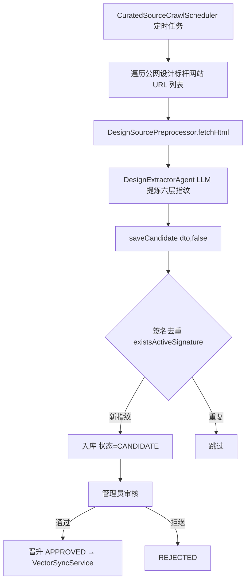
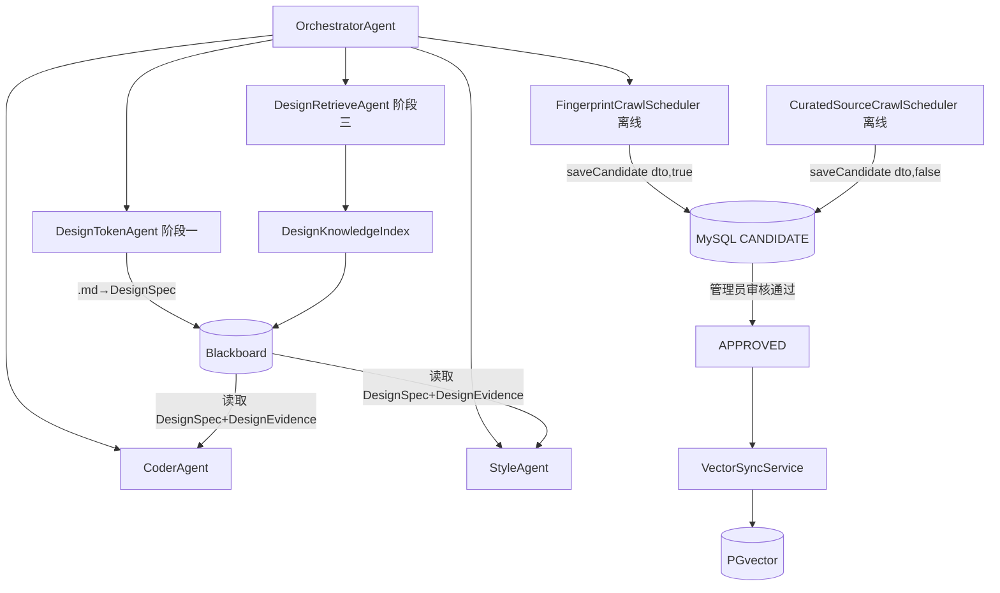

# RAG 设计详解

> CreatAi 项目的设计风格召回增强生成（RAG）体系

---

## 一、整体设计思路

本项目实现了一套**三阶段渐进增强 RAG 体系**，专门服务于 AI 代码生成时的设计风格召回。

核心思路：AI 生成代码前，先从知识库中召回真实应用的设计指纹（颜色、布局、组件、交互等六层结构），将这些「设计证据」注入到 CoderAgent 和 StyleAgent 的提示词上下文中，使生成结果不依赖 LLM 凭空臆测，而是有据可依。

```
阶段一（先验）  → DesignTokenAgent     → 静态 .md 设计规范  → DesignSpec
阶段二（离线）  → DesignExtractorAgent → LLM 提炼六层指纹  → DesignFingerprint（入库）
阶段三（运行时）→ DesignRetrieveAgent  → 向量/结构化检索   → DesignEvidence（注入 Blackboard）
```

三阶段并非互斥：阶段一始终运行（先验兜底），阶段二离线异步运行（持续建库），阶段三在配置开启时运行时叠加（增强注入）。

---

## 二、在完整流水线中的位置

```
① ProductAgent         需求解析 → RequirementDoc
② ArchitectAgent        技术选型 → GenerationPlan（含 styleProfile 识别）
③ DesignTokenAgent      ★阶段一：加载静态设计规范 → DesignSpec 写入 Blackboard
④ DesignRetrieveAgent   ★阶段三：运行时召回 → DesignEvidence 写入 Blackboard  ← RAG 核心
⑤ ImageAgent            搜图 → imageMap
   ┌──────────────────────────────────────────────────────────────┐
   │ 并发                                                          │
⑥  CoderAgent（读 DesignSpec + DesignEvidence 生成 HTML/JS）       │
⑦  StyleAgent（读 DesignSpec + DesignEvidence 生成 CSS）           │
   └──────────────────────────────────────────────────────────────┘
⑧ CriticAgent           质检 + 反馈循环（最多 N 轮）
⑨ DeployAgent           npm build + COS 上传（可选）
```

---

## 三、三阶段详解

### 3.1 阶段一：先验静态规范（DesignTokenAgent）

**职责**：在任何 RAG 检索发生之前，先给后续 Agent 一套确定的 CSS Token 契约。

**流程**：

```
ArchitectAgent 输出 styleProfile（如 "ecommerce"）
    ↓
DesignProfileResolver.normalizeProfile()
    ├─ 空值 → "default"
    ├─ 不在白名单 → "default"
    ├─ confidence < 0.6 → "default"
    └─ 合法 → 原值
    ↓
DesignProfileResolver.loadDesignSpec()
    ├─ 读 classpath:skill/designs/{profile}.md
    ├─ 解析失败 → buildBuiltinDefaultSpec()（Java 硬编码兜底）
    └─ 成功 → DesignSpec
    ↓
Blackboard.putDesignSpec(DesignSpec)
```

**静态规范文件**（`resources/skill/designs/`，共 7 个）：

| 文件 | profile | 调性 | 主色 |
|------|---------|------|------|
| `default.md` | default | 中性通用兜底 | `#4f46e5` 靛蓝 |
| `startup.md` | startup | 现代科技 SaaS | `#7c3aed` 紫色 |
| `enterprise.md` | enterprise | 稳重 B 端企业 | `#2563eb` 商务蓝 |
| `dashboard.md` | dashboard | 数据看板后台 | `#0d9488` 青绿 |
| `ecommerce.md` | ecommerce | 电商转化导向 | `#ea580c` 橙色 |
| `portfolio.md` | portfolio | 极简个人作品集 | `#111111` 近黑 |
| `landing.md` | landing | 营销落地页强引导 | `#e11d48` 玫红 |

每个 `.md` 文件结构：

```markdown
# {profile} Design Spec
priority: 60

## tokens
--color-primary: #ea580c
--color-secondary: #f97316
--font-size-base: 16px
...

## tone
活力、冲动、转化驱动...

## layout
hero-banner → product-grid → promo-banner → footer...

## preferred
大图、标价醒目、CTA 按钮突出...

## interaction
悬停放大、加购动效...

## forbidden
大段文字、低饱和色...
```

**DesignSpec 是 CoderAgent/StyleAgent 的唯一权威 CSS Token 契约**，避免两个并发 Agent 使用不一致的变量名。

---

### 3.2 阶段二：离线知识库建设（DesignExtractorAgent + FingerprintCrawlScheduler）

**职责**：持续爬取精选应用页面，提炼六层设计指纹，审核后入库。

#### 爬取流程

```
FingerprintCrawlScheduler（定时任务，agent.fingerprint.crawl.enabled=true）
    ↓
查询 priority=99 且已部署的精选应用
    ↓
DesignSourcePreprocessor.fetchHtml()
    ├─ SSRF 防护：拒绝内网段（localhost / 10.* / 9.* / 11.* / 21.* / 30.*）
    └─ Prompt Injection 防护：剥离 <script>，仅保留结构骨架和 CSS 声明
    ↓
DesignExtractorAgent（LLM）→ 提炼六层指纹 JSON
    ↓
FingerprintParser.parse()
    ├─ JSON Schema 校验（六层结构完整性）
    ├─ 置信度计算（基于字段完整度和关键词命中数）
    └─ 输出 DesignFingerprintDTO
    ↓
DesignFingerprintService.saveCandidate()
    ├─ MD5 签名去重（styleProfile + layout.skeleton + tokens + components）
    └─ 状态 = CANDIDATE 入库
```

#### 指纹状态流转

```
CANDIDATE ──→ (管理员审核通过，confidence ≥ 0.7) ──→ APPROVED
                    ↓
              VectorSyncService.syncOnApprove()
                    ↓
              EmbeddingService.buildSemanticText()  构造六层语义文本
                    ↓
              EmbeddingService.embed()              向量化（1536 维）
                    ↓
              DesignFingerprintVectorRepo.upsert()  UPSERT 入 PGvector

CANDIDATE ──→ (管理员拒绝) ──→ REJECTED
                    ↓
              vectorRepo.deactivate()               软删除向量（is_active = false）

APPROVED  ──→ (归档)        ──→ ARCHIVED
                    ↓
              vectorRepo.deactivate()
```

#### 入库治理规则

| 规则 | 实现 | 说明 |
|------|------|------|
| 置信度门控 | `CONFIDENCE_GATE = 0.7` | 低于此值不允许晋升 APPROVED |
| 防同质化 | `MAX_SELF_FED_RATIO = 0.3` | 自产反哺指纹占 APPROVED 池比例上限 30% |
| 签名去重 | MD5 签名 | 相同 styleProfile + 骨架 + token + 组件，跳过入库 |

#### 六层指纹结构

```
① tokens       → 配色比例、字号阶梯、圆角、阴影等 CSS Token
② layout       → 区块骨架（hero → grid → cta → footer）、留白、视觉重心
③ components   → 组件模式关键词列表
④ interaction  → 动效、过渡、悬停反馈
⑤ antiPatterns → 反模式（负样本，明确告知 LLM 避免什么）
⑥ styleProfile + tone → 风格归类标签、整体调性描述
```

---

### 3.3 阶段三：运行时召回（DesignRetrieveAgent + DesignKnowledgeIndex）

**职责**：在代码生成前，从知识库中检索与当前需求最匹配的已有设计案例，作为「证据」注入。

#### 召回流程

```
DesignRetrieveAgent.run()
    ↓
resolveProfile()      从 GenerationPlan 取 styleProfile
    ↓
buildQueryTags()      从 RequirementDoc 提取功能关键词（如 "商品列表" "购物车" "筛选"）
    ↓
DesignKnowledgeIndex.retrieve(profile, queryTags, topK)
    ↓（三层检索，见下文）
DesignEvidence（含来源 channel + top-k 证据列表）
    ↓
Blackboard.putDesignEvidence(DesignEvidence)
```

#### 三层检索链路

`DesignKnowledgeIndex` 实现三层检索并合并排序：

```
优先级 1：STATIC_FALLBACK（始终排第一，先验 DesignSpec 作为兜底证据）
优先级 2：VECTOR_3B（PGvector cosine 相似度，开关控制）
优先级 3：STRUCTURAL_3A（MySQL 结构化字段 + Java 软匹配）
```

```
           ┌──────────────────────────────────────────────────────┐
           │                 DesignKnowledgeIndex                  │
           │                                                        │
  query    │  ① STATIC_FALLBACK                                     │
  tags  →  │    Blackboard.getDesignSpec() → priority=50            │
           │                                                        │
           │  ② VECTOR_3B (agent.retrieve.vector.enabled=true)      │
           │    EmbeddingService.embed(queryText)                   │
           │    → pgvector: ORDER BY embedding <=> ?::vector        │
           │    → cosine_similarity ≥ min-similarity(0.7)          │
           │    → LIMIT topK，priority=80                           │
           │                                                        │
           │  ③ STRUCTURAL_3A (fallback when 3B disabled/empty)     │
           │    MySQL: style_profile + status=APPROVED              │
           │    → Java softMatchScore（tone/preferred/layout 词命中）│
           │    → priority=60                                        │
           │                                                        │
           │  合并排序：priority DESC → confidence DESC              │
           │            → updatedAt DESC → softMatchScore DESC       │
           └──────────────────────────────────────────────────────┘
                              ↓
                         DesignEvidence
                    （channel 标记 + top-k 条目）
```

#### 向量化文本格式

存储端和检索端使用**完全一致**的文本构造格式，最大化 cosine 匹配效果：

```
[设计风格: ecommerce]
[设计Token: 配色=橙色暖色调 字号阶梯=16/24/32px 圆角=8px 阴影=medium]
[布局: hero-banner → product-grid → promo-banner → footer]
[组件: 商品卡片 价格标签 加购按钮 轮播图]
[交互: 悬停放大 加购动效 图片懒加载]
[避免: 大段文字 低饱和色 过于简约]
[调性: 活力 冲动 转化驱动 购物节奏感]
```

---

## 四、数据流与 Blackboard

`Blackboard` 是各 Agent 之间共享数据的核心（线程安全的 `ConcurrentHashMap`）：

```
                    写入                                读取
ArchitectAgent  →  GenerationPlan（含 styleProfile）
DesignTokenAgent→  DesignSpec（CSS Token 契约）    ←  CoderAgent
                                                   ←  StyleAgent
DesignRetrieve  →  DesignEvidence（检索证据）       ←  CoderAgent
                                                   ←  StyleAgent
ImageAgent      →  imageMap（图片 URL 映射）        ←  CoderAgent
CoderAgent      →  generatedFiles（HTML/JS）        ←  CriticAgent
StyleAgent      →  generatedStyles（CSS）           ←  CriticAgent
CriticAgent     →  criticFeedback（反馈）           ←  CoderAgent（重试循环）
```

---

## 五、降级策略（四重保障）

系统设计了严密的降级链，任何一环失败都不会中断流水线：

```
DesignRetrieveAgent 检索异常
    ↓（降级，不 sink.error()）
CoderAgent/StyleAgent 仅使用 DesignSpec（阶段一先验）
    ↓（若 DesignSpec 加载失败）
DesignProfileResolver 读取 default.md
    ↓（若 default.md 缺失/损坏）
DesignTokenAgent try-catch → buildBuiltinDefaultSpec()（Java 硬编码 token）
    ↓（若整个 DesignTokenAgent 崩溃）
OrchestratorAgent 捕获异常 → 跳过该步骤，后续 Agent 使用空 DesignSpec
```

---

## 六、配置项速查

```yaml
# 是否启用运行时召回（需要先建立知识库）
agent.retrieve.enabled: false

# 召回数量
agent.retrieve.top-k: 2

# 是否启用 PGvector 向量检索（需要 PostgreSQL + pgvector 扩展）
agent.retrieve.vector.enabled: false

# cosine 相似度阈值（低于此值不纳入结果）
agent.retrieve.vector.min-similarity: 0.7

# 是否启用指纹爬取定时任务
agent.fingerprint.crawl.enabled: false

# PGvector 独立数据源
spring.pgvector.datasource.url: jdbc:postgresql://...
spring.pgvector.datasource.username: ...
spring.pgvector.datasource.password: ...
```

---

## 七、安全设计

| 威胁 | 防护措施 | 实现位置 |
|------|----------|----------|
| **SSRF** | 拒绝访问 localhost、10.\*、9.\*、11.\*、21.\*、30.\* 等内网段 | `DesignSourcePreprocessor.isDisallowedHost()` |
| **Prompt Injection** | 剥离 `<script>` 标签，仅保留结构骨架和 CSS 声明 | `DesignSourcePreprocessor.summarizeHtml()` |
| **路径穿越** | profile 值只从白名单枚举拼接 classpath 路径，无用户输入参与 | `DesignProfileResolver` |
| **数据污染** | 置信度 < 0.7 不得晋升 APPROVED；自产占比超 30% 拒绝晋升 | `DesignFingerprintServiceImpl` |
| **向量注入** | 向量存储操作使用 `?::vector` 参数绑定，非字符串拼接 | `DesignFingerprintVectorRepository` |

---

## 八、核心类关系图

```
OrchestratorAgent
    ├── DesignTokenAgent ─────────── DesignProfileResolver
    │                                      └── classpath:skill/designs/*.md
    │
    ├── DesignRetrieveAgent ──────── DesignKnowledgeIndex
    │                                      ├── EmbeddingService（向量化）
    │                                      ├── DesignFingerprintVectorRepository（PGvector）
    │                                      └── DesignFingerprintMapper（MySQL 结构化）
    │
    ├── CoderAgent ─────────────────── 读 Blackboard: DesignSpec + DesignEvidence
    ├── StyleAgent ─────────────────── 读 Blackboard: DesignSpec + DesignEvidence
    │
    └── [离线] FingerprintCrawlScheduler
              └── DesignExtractorAgent（LLM 提炼六层指纹）
                       └── VectorSyncService（APPROVED 后触发向量同步）
```

---

## 九、为什么这样设计

| 设计决策 | 原因 |
|----------|------|
| **三阶段而非一步 RAG** | 阶段一（静态规范）确保 CoderAgent/StyleAgent 始终有确定的 CSS Token 契约，不受检索质量影响；阶段三仅作增强，失败不影响基础生成 |
| **PGvector 独立数据源** | 避免 pgvector 的 `vector` 类型和 `<=>` 操作符被 MyBatis-Flex 自动扫描报错，用 `JdbcTemplate` 原生 SQL 操作 |
| **存储端/检索端文本格式一致** | 最大化语义文本与向量空间的对齐，减少 embedding 空间的分布偏差 |
| **软匹配作为结构化检索兜底** | 无 EmbeddingModel 时仍可基于词条命中数做粗粒度排序，保证功能完整性 |
| **静态 fallback 始终排第一** | 无论检索结果如何，先验 DesignSpec 始终作为证据之一传递给 LLM，保证风格一致性 |
| **置信度门控 + 占比上限** | 防止低质量指纹污染知识库；防止自产数据形成信息茧房，保持多样性 |

---

## 十、自产占比控制机制

### 10.1 计算逻辑

在 `DesignFingerprintServiceImpl.exceedsSelfFedQuotaAfterApprove()` 中：

```java
// 自产占比 = (selfFedApproved + 1) / (approvedTotal + 1)
// 阈值上限 = 30%（即 MAX_SELF_FED_RATIO = 0.3）
// 若自产占比 > 0.3 → 拒绝晋升 APPROVED
```

- **selfFedApproved**：`design_fingerprint` 表中，同 `styleProfile` 下 `source_type = 'SELF_FED_FINGERPRINT'` 且 `status = 'APPROVED'` 的记录数
- **approvedTotal**：同 `styleProfile` 下 `status = 'APPROVED'` 的总记录数（含自产 + 外部精选）

加一的原因是计算的是"审批通过后"的占比，防止自产指纹充斥知识库形成信息茧房。

### 10.2 来源类型

| 常量 | 数据库值 | 含义 |
|------|----------|------|
| `SOURCE_CURATED` | `EXTRACTED_FINGERPRINT` | 外部精选（管理员手动收录或自动爬取） |
| `SOURCE_SELF_FED` | `SELF_FED_FINGERPRINT` | 自产反哺（系统爬取自己部署的应用） |

---

## 十一、外部精选案例自动导入方案

### 11.1 现状

当前仅 `FingerprintCrawlScheduler` 调用 `saveCandidate(dto, true)` 处理自产指纹，代码中无 `saveCandidate(dto, false)` 的调用方——即外部精选入库通道缺失。

### 11.2 方案：自动爬取 + 管理员审核

采用"系统自动爬取 + 管理员仅做审核"的闭环：



### 11.3 与自产爬取的区别

| 维度 | 自产爬取 | 外部精选爬取 |
|------|----------|--------------|
| 数据来源 | 系统自身部署的应用页面 | 公网设计标杆网站（Linear、Stripe 等） |
| saveCandidate | `(dto, true)` | `(dto, false)` |
| 用途 | 反哺自身设计体系 | 丰富知识库多样性 |
| 占比约束 | 受 30% 上限限制 | 无限制 |

### 11.4 需要新建的文件

| 文件 | 职责 |
|------|------|
| `CuratedSource.java` | 外部来源 URL 实体（url, name, category, enabled） |
| `CuratedSourceMapper.java` | MyBatis-Flex 数据访问 |
| `CuratedSourceServiceImpl.java` | 核心逻辑：`crawlAndImport()` 方法，SSRF 防护，调用 `saveCandidate(dto, false)` |
| `CuratedSourceCrawlScheduler.java` | `@Scheduled` 定时调度器 |
| SQL 建表脚本 | `curated_source` 表建表语句 |

### 11.5 配置项

```yaml
agent.curated.crawl.enabled: false        # 是否启用外部精选爬取
agent.curated.crawl.interval-ms: 604800000  # 爬取间隔，默认 7 天
```

### 11.6 爬取频率与去重

**爬取来源**：公网设计标杆网站（Linear、Stripe、Vercel、Apple、Notion 等），而非系统自部署页面。

**频率策略**：

- 公网设计标杆网站的设计风格不常变动（月/年级更新）
- 默认 7 天爬取一次即可
- 可持续运行，每次周期性地扫描是否有新发现

**去重保障**：`saveCandidate()` 中已有签名去重（`existsActiveSignature`），基于 `MD5(styleProfile | 布局骨架 | 配色 | 圆角 | 阴影 | 组件列表)`，相同设计指纹会自动跳过，不会重复入库。

---

## 十二、Style Profile 覆盖范围

### 12.1 当前三层约束

| 约束层 | 位置 | 说明 |
|--------|------|------|
| LLM prompt | `agent-extractor-system-prompt.txt` | 要求 LLM 输出只能取固定的枚举值 |
| Java 白名单 | `DesignProfileResolver.PROFILE_WHITELIST` | 不在白名单的值统一归为 `default` |
| 静态规范文件 | `classpath:skill/designs/*.md` | 每个 profile 对应一个 .md 规范文件 |

### 12.2 当前 7 个 Profile

| profile | 调性 | 典型场景 |
|---------|------|----------|
| default | 中性通用 | 兜底 |
| startup | 现代科技 SaaS | 创业公司官网 |
| enterprise | 稳重 B 端企业 | 企业后台 |
| dashboard | 数据看板后台 | 仪表盘 |
| ecommerce | 电商转化导向 | 电商网站 |
| portfolio | 极简个人作品集 | 个人网站 |
| landing | 营销落地页 | 推广页 |

### 12.3 是否需要扩展？

**结论：现阶段保持 7 个 profile 即可，无需急于扩展。**

理由：

1. **向量检索不依赖精确分类**：PGvector 的 cosine 相似度是基于语义文本的全局匹配，不限定 profile 标签。即使新风格没有被 profile 精确覆盖，向量检索仍可能命中相近的指纹。

2. **7 个 profile 已覆盖主流场景**：startup、enterprise、ecommerce、dashboard、landing、portfolio 涵盖了绝大多数商业和产品设计场景。

3. **tone 字段提供补充维度**："活力/极简/商务稳重/转化驱动"等调性描述在向量匹配中起到细粒度区分作用，同一 profile 下不同 tone 的设计也能被区分召回。

4. **如需扩展**：新增 profile 需同步完成三步——在 LLM prompt 中添加枚举值、在 `PROFILE_WHITELIST` 中添加白名单、编写对应的 `skill/designs/{profile}.md` 静态规范文件。

---

## 十三、完整架构总结



### 核心原则

- **先验兜底**：静态 .md 规范始终生效，不依赖知识库质量
- **离线建库**：自产 + 外部双通道持续丰富知识库
- **运行时增强**：向量检索作为叠加层，失败不影响基础生成
- **质量把控**：置信度门控 + 自产占比上限 + 签名去重，防止知识库劣化
- **管理员减负**：系统自动爬取和提炼指纹，管理员仅做审核操作
```
