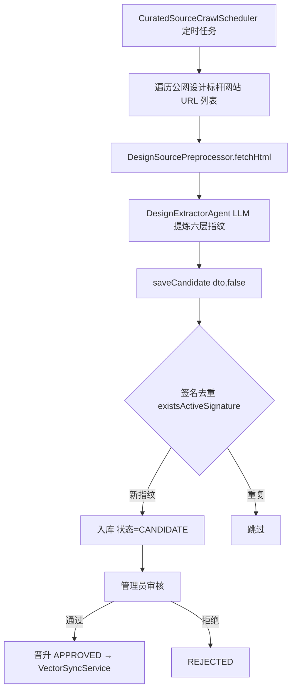
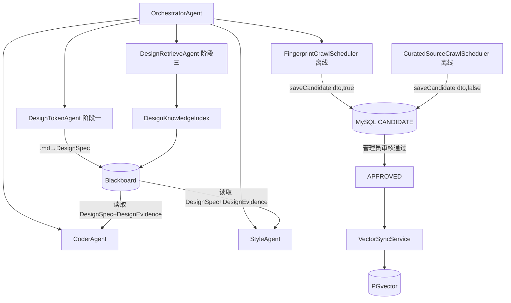

# RAG 设计详解

> CreatAi 项目的设计风格召回增强生成（RAG）体系

---

## 一、整体设计思路

本项目实现了一套**三阶段渐进增强 RAG 体系**，专门服务于 AI 代码生成时的设计风格召回。

核心思路：AI 生成代码前，先从知识库中召回真实应用的设计指纹（颜色、布局、组件、交互等六层结构），将这些「设计证据」注入到 CoderAgent 和 StyleAgent 的提示词上下文中，使生成结果不依赖 LLM 凭空臆测，而是有据可依。

```
阶段一（先验）  → DesignTokenAgent     → 静态 .md 设计规范  → DesignSpec
阶段二（离线）  → DesignExtractorAgent → LLM 提炼六层指纹  → DesignFingerprint（入库）
阶段三（运行时）→ DesignRetrieveAgent  → 向量/结构化检索   → DesignEvidence（注入 Blackboard）
```

三阶段并非互斥：阶段一始终运行（先验兜底），阶段二离线异步运行（持续建库），阶段三在配置开启时运行时叠加（增强注入）。

---

## 二、在完整流水线中的位置

```
① ProductAgent         需求解析 → RequirementDoc
② ArchitectAgent        技术选型 → GenerationPlan（含 styleProfile 识别）
③ DesignTokenAgent      ★阶段一：加载静态设计规范 → DesignSpec 写入 Blackboard
④ DesignRetrieveAgent   ★阶段三：运行时召回 → DesignEvidence 写入 Blackboard  ← RAG 核心
⑤ ImageAgent            搜图 → imageMap
   ┌──────────────────────────────────────────────────────────────┐
   │ 并发                                                          │
⑥  CoderAgent（读 DesignSpec + DesignEvidence 生成 HTML/JS）       │
⑦  StyleAgent（读 DesignSpec + DesignEvidence 生成 CSS）           │
   └──────────────────────────────────────────────────────────────┘
⑧ CriticAgent           质检 + 反馈循环（最多 N 轮）
⑨ DeployAgent           npm build + COS 上传（可选）
```

---

## 三、三阶段详解

### 3.1 阶段一：先验静态规范（DesignTokenAgent）

**职责**：在任何 RAG 检索发生之前，先给后续 Agent 一套确定的 CSS Token 契约。

**流程**：

```
ArchitectAgent 输出 styleProfile（如 "ecommerce"）
    ↓
DesignProfileResolver.normalizeProfile()
    ├─ 空值 → "default"
    ├─ 不在白名单 → "default"
    ├─ confidence < 0.6 → "default"
    └─ 合法 → 原值
    ↓
DesignProfileResolver.loadDesignSpec()
    ├─ 读 classpath:skill/designs/{profile}.md
    ├─ 解析失败 → buildBuiltinDefaultSpec()（Java 硬编码兜底）
    └─ 成功 → DesignSpec
    ↓
Blackboard.putDesignSpec(DesignSpec)
```

**静态规范文件**（`resources/skill/designs/`，共 7 个）：

| 文件 | profile | 调性 | 主色 |
|------|---------|------|------|
| `default.md` | default | 中性通用兜底 | `#4f46e5` 靛蓝 |
| `startup.md` | startup | 现代科技 SaaS | `#7c3aed` 紫色 |
| `enterprise.md` | enterprise | 稳重 B 端企业 | `#2563eb` 商务蓝 |
| `dashboard.md` | dashboard | 数据看板后台 | `#0d9488` 青绿 |
| `ecommerce.md` | ecommerce | 电商转化导向 | `#ea580c` 橙色 |
| `portfolio.md` | portfolio | 极简个人作品集 | `#111111` 近黑 |
| `landing.md` | landing | 营销落地页强引导 | `#e11d48` 玫红 |

每个 `.md` 文件结构：

```markdown
# {profile} Design Spec
priority: 60

## tokens
--color-primary: #ea580c
--color-secondary: #f97316
--font-size-base: 16px
...

## tone
活力、冲动、转化驱动...

## layout
hero-banner → product-grid → promo-banner → footer...

## preferred
大图、标价醒目、CTA 按钮突出...

## interaction
悬停放大、加购动效...

## forbidden
大段文字、低饱和色...
```

**DesignSpec 是 CoderAgent/StyleAgent 的唯一权威 CSS Token 契约**，避免两个并发 Agent 使用不一致的变量名。

---

### 3.2 阶段二：离线知识库建设（DesignExtractorAgent + FingerprintCrawlScheduler）

**职责**：持续爬取精选应用页面，提炼六层设计指纹，审核后入库。

#### 爬取流程

```
FingerprintCrawlScheduler（定时任务，agent.fingerprint.crawl.enabled=true）
    ↓
查询 priority=99 且已部署的精选应用
    ↓
DesignSourcePreprocessor.fetchHtml()
    ├─ SSRF 防护：拒绝内网段（localhost / 10.* / 9.* / 11.* / 21.* / 30.*）
    └─ Prompt Injection 防护：剥离 <script>，仅保留结构骨架和 CSS 声明
    ↓
DesignExtractorAgent（LLM）→ 提炼六层指纹 JSON
    ↓
FingerprintParser.parse()
    ├─ JSON Schema 校验（六层结构完整性）
    ├─ 置信度计算（基于字段完整度和关键词命中数）
    └─ 输出 DesignFingerprintDTO
    ↓
DesignFingerprintService.saveCandidate()
    ├─ MD5 签名去重（styleProfile + layout.skeleton + tokens + components）
    └─ 状态 = CANDIDATE 入库
```

#### 指纹状态流转

```
CANDIDATE ──→ (管理员审核通过，confidence ≥ 0.7) ──→ APPROVED
                    ↓
              VectorSyncService.syncOnApprove()
                    ↓
              EmbeddingService.buildSemanticText()  构造六层语义文本
                    ↓
              EmbeddingService.embed()              向量化（1536 维）
                    ↓
              DesignFingerprintVectorRepo.upsert()  UPSERT 入 PGvector

CANDIDATE ──→ (管理员拒绝) ──→ REJECTED
                    ↓
              vectorRepo.deactivate()               软删除向量（is_active = false）

APPROVED  ──→ (归档)        ──→ ARCHIVED
                    ↓
              vectorRepo.deactivate()
```

#### 入库治理规则

| 规则 | 实现 | 说明 |
|------|------|------|
| 置信度门控 | `CONFIDENCE_GATE = 0.7` | 低于此值不允许晋升 APPROVED |
| 防同质化 | `MAX_SELF_FED_RATIO = 0.3` | 自产反哺指纹占 APPROVED 池比例上限 30% |
| 签名去重 | MD5 签名 | 相同 styleProfile + 骨架 + token + 组件，跳过入库 |

#### 六层指纹结构

```
① tokens       → 配色比例、字号阶梯、圆角、阴影等 CSS Token
② layout       → 区块骨架（hero → grid → cta → footer）、留白、视觉重心
③ components   → 组件模式关键词列表
④ interaction  → 动效、过渡、悬停反馈
⑤ antiPatterns → 反模式（负样本，明确告知 LLM 避免什么）
⑥ styleProfile + tone → 风格归类标签、整体调性描述
```

---

### 3.3 阶段三：运行时召回（DesignRetrieveAgent + DesignKnowledgeIndex）

**职责**：在代码生成前，从知识库中检索与当前需求最匹配的已有设计案例，作为「证据」注入。

#### 召回流程

```
DesignRetrieveAgent.run()
    ↓
resolveProfile()      从 GenerationPlan 取 styleProfile
    ↓
buildQueryTags()      从 RequirementDoc 提取功能关键词（如 "商品列表" "购物车" "筛选"）
    ↓
DesignKnowledgeIndex.retrieve(profile, queryTags, topK)
    ↓（三层检索，见下文）
DesignEvidence（含来源 channel + top-k 证据列表）
    ↓
Blackboard.putDesignEvidence(DesignEvidence)
```

#### 三层检索链路

`DesignKnowledgeIndex` 实现三层检索并合并排序：

```
优先级 1：STATIC_FALLBACK（始终排第一，先验 DesignSpec 作为兜底证据）
优先级 2：VECTOR_3B（PGvector cosine 相似度，开关控制）
优先级 3：STRUCTURAL_3A（MySQL 结构化字段 + Java 软匹配）
```

```
           ┌──────────────────────────────────────────────────────┐
           │                 DesignKnowledgeIndex                  │
           │                                                        │
  query    │  ① STATIC_FALLBACK                                     │
  tags  →  │    Blackboard.getDesignSpec() → priority=50            │
           │                                                        │
           │  ② VECTOR_3B (agent.retrieve.vector.enabled=true)      │
           │    EmbeddingService.embed(queryText)                   │
           │    → pgvector: ORDER BY embedding <=> ?::vector        │
           │    → cosine_similarity ≥ min-similarity(0.7)          │
           │    → LIMIT topK，priority=80                           │
           │                                                        │
           │  ③ STRUCTURAL_3A (fallback when 3B disabled/empty)     │
           │    MySQL: style_profile + status=APPROVED              │
           │    → Java softMatchScore（tone/preferred/layout 词命中）│
           │    → priority=60                                        │
           │                                                        │
           │  合并排序：priority DESC → confidence DESC              │
           │            → updatedAt DESC → softMatchScore DESC       │
           └──────────────────────────────────────────────────────┘
                              ↓
                         DesignEvidence
                    （channel 标记 + top-k 条目）
```

#### 向量化文本格式

存储端和检索端使用**完全一致**的文本构造格式，最大化 cosine 匹配效果：

```
[设计风格: ecommerce]
[设计Token: 配色=橙色暖色调 字号阶梯=16/24/32px 圆角=8px 阴影=medium]
[布局: hero-banner → product-grid → promo-banner → footer]
[组件: 商品卡片 价格标签 加购按钮 轮播图]
[交互: 悬停放大 加购动效 图片懒加载]
[避免: 大段文字 低饱和色 过于简约]
[调性: 活力 冲动 转化驱动 购物节奏感]
```

---

## 四、数据流与 Blackboard

`Blackboard` 是各 Agent 之间共享数据的核心（线程安全的 `ConcurrentHashMap`）：

```
                    写入                                读取
ArchitectAgent  →  GenerationPlan（含 styleProfile）
DesignTokenAgent→  DesignSpec（CSS Token 契约）    ←  CoderAgent
                                                   ←  StyleAgent
DesignRetrieve  →  DesignEvidence（检索证据）       ←  CoderAgent
                                                   ←  StyleAgent
ImageAgent      →  imageMap（图片 URL 映射）        ←  CoderAgent
CoderAgent      →  generatedFiles（HTML/JS）        ←  CriticAgent
StyleAgent      →  generatedStyles（CSS）           ←  CriticAgent
CriticAgent     →  criticFeedback（反馈）           ←  CoderAgent（重试循环）
```

---

## 五、降级策略（四重保障）

系统设计了严密的降级链，任何一环失败都不会中断流水线：

```
DesignRetrieveAgent 检索异常
    ↓（降级，不 sink.error()）
CoderAgent/StyleAgent 仅使用 DesignSpec（阶段一先验）
    ↓（若 DesignSpec 加载失败）
DesignProfileResolver 读取 default.md
    ↓（若 default.md 缺失/损坏）
DesignTokenAgent try-catch → buildBuiltinDefaultSpec()（Java 硬编码 token）
    ↓（若整个 DesignTokenAgent 崩溃）
OrchestratorAgent 捕获异常 → 跳过该步骤，后续 Agent 使用空 DesignSpec
```

---

## 六、配置项速查

```yaml
# 是否启用运行时召回（需要先建立知识库）
agent.retrieve.enabled: false

# 召回数量
agent.retrieve.top-k: 2

# 是否启用 PGvector 向量检索（需要 PostgreSQL + pgvector 扩展）
agent.retrieve.vector.enabled: false

# cosine 相似度阈值（低于此值不纳入结果）
agent.retrieve.vector.min-similarity: 0.7

# 是否启用指纹爬取定时任务
agent.fingerprint.crawl.enabled: false

# PGvector 独立数据源
spring.pgvector.datasource.url: jdbc:postgresql://...
spring.pgvector.datasource.username: ...
spring.pgvector.datasource.password: ...
```

---

## 七、安全设计

| 威胁 | 防护措施 | 实现位置 |
|------|----------|----------|
| **SSRF** | 拒绝访问 localhost、10.\*、9.\*、11.\*、21.\*、30.\* 等内网段 | `DesignSourcePreprocessor.isDisallowedHost()` |
| **Prompt Injection** | 剥离 `<script>` 标签，仅保留结构骨架和 CSS 声明 | `DesignSourcePreprocessor.summarizeHtml()` |
| **路径穿越** | profile 值只从白名单枚举拼接 classpath 路径，无用户输入参与 | `DesignProfileResolver` |
| **数据污染** | 置信度 < 0.7 不得晋升 APPROVED；自产占比超 30% 拒绝晋升 | `DesignFingerprintServiceImpl` |
| **向量注入** | 向量存储操作使用 `?::vector` 参数绑定，非字符串拼接 | `DesignFingerprintVectorRepository` |

---

## 八、核心类关系图

```
OrchestratorAgent
    ├── DesignTokenAgent ─────────── DesignProfileResolver
    │                                      └── classpath:skill/designs/*.md
    │
    ├── DesignRetrieveAgent ──────── DesignKnowledgeIndex
    │                                      ├── EmbeddingService（向量化）
    │                                      ├── DesignFingerprintVectorRepository（PGvector）
    │                                      └── DesignFingerprintMapper（MySQL 结构化）
    │
    ├── CoderAgent ─────────────────── 读 Blackboard: DesignSpec + DesignEvidence
    ├── StyleAgent ─────────────────── 读 Blackboard: DesignSpec + DesignEvidence
    │
    └── [离线] FingerprintCrawlScheduler
              └── DesignExtractorAgent（LLM 提炼六层指纹）
                       └── VectorSyncService（APPROVED 后触发向量同步）
```

---

## 九、为什么这样设计

| 设计决策 | 原因 |
|----------|------|
| **三阶段而非一步 RAG** | 阶段一（静态规范）确保 CoderAgent/StyleAgent 始终有确定的 CSS Token 契约，不受检索质量影响；阶段三仅作增强，失败不影响基础生成 |
| **PGvector 独立数据源** | 避免 pgvector 的 `vector` 类型和 `<=>` 操作符被 MyBatis-Flex 自动扫描报错，用 `JdbcTemplate` 原生 SQL 操作 |
| **存储端/检索端文本格式一致** | 最大化语义文本与向量空间的对齐，减少 embedding 空间的分布偏差 |
| **软匹配作为结构化检索兜底** | 无 EmbeddingModel 时仍可基于词条命中数做粗粒度排序，保证功能完整性 |
| **静态 fallback 始终排第一** | 无论检索结果如何，先验 DesignSpec 始终作为证据之一传递给 LLM，保证风格一致性 |
| **置信度门控 + 占比上限** | 防止低质量指纹污染知识库；防止自产数据形成信息茧房，保持多样性 |

---

## 十、自产占比控制机制

### 10.1 计算逻辑

在 `DesignFingerprintServiceImpl.exceedsSelfFedQuotaAfterApprove()` 中：

```java
// 自产占比 = (selfFedApproved + 1) / (approvedTotal + 1)
// 阈值上限 = 30%（即 MAX_SELF_FED_RATIO = 0.3）
// 若自产占比 > 0.3 → 拒绝晋升 APPROVED
```

- **selfFedApproved**：`design_fingerprint` 表中，同 `styleProfile` 下 `source_type = 'SELF_FED_FINGERPRINT'` 且 `status = 'APPROVED'` 的记录数
- **approvedTotal**：同 `styleProfile` 下 `status = 'APPROVED'` 的总记录数（含自产 + 外部精选）

加一的原因是计算的是"审批通过后"的占比，防止自产指纹充斥知识库形成信息茧房。

### 10.2 来源类型

| 常量 | 数据库值 | 含义 |
|------|----------|------|
| `SOURCE_CURATED` | `EXTRACTED_FINGERPRINT` | 外部精选（管理员手动收录或自动爬取） |
| `SOURCE_SELF_FED` | `SELF_FED_FINGERPRINT` | 自产反哺（系统爬取自己部署的应用） |

---

## 十一、外部精选案例自动导入方案

### 11.1 现状

当前仅 `FingerprintCrawlScheduler` 调用 `saveCandidate(dto, true)` 处理自产指纹，代码中无 `saveCandidate(dto, false)` 的调用方——即外部精选入库通道缺失。

### 11.2 方案：自动爬取 + 管理员审核

采用"系统自动爬取 + 管理员仅做审核"的闭环：



### 11.3 与自产爬取的区别

| 维度 | 自产爬取 | 外部精选爬取 |
|------|----------|--------------|
| 数据来源 | 系统自身部署的应用页面 | 公网设计标杆网站（Linear、Stripe 等） |
| saveCandidate | `(dto, true)` | `(dto, false)` |
| 用途 | 反哺自身设计体系 | 丰富知识库多样性 |
| 占比约束 | 受 30% 上限限制 | 无限制 |

### 11.4 需要新建的文件

| 文件 | 职责 |
|------|------|
| `CuratedSource.java` | 外部来源 URL 实体（url, name, category, enabled） |
| `CuratedSourceMapper.java` | MyBatis-Flex 数据访问 |
| `CuratedSourceServiceImpl.java` | 核心逻辑：`crawlAndImport()` 方法，SSRF 防护，调用 `saveCandidate(dto, false)` |
| `CuratedSourceCrawlScheduler.java` | `@Scheduled` 定时调度器 |
| SQL 建表脚本 | `curated_source` 表建表语句 |

### 11.5 配置项

```yaml
agent.curated.crawl.enabled: false        # 是否启用外部精选爬取
agent.curated.crawl.interval-ms: 604800000  # 爬取间隔，默认 7 天
```

### 11.6 爬取频率与去重

**爬取来源**：公网设计标杆网站（Linear、Stripe、Vercel、Apple、Notion 等），而非系统自部署页面。

**频率策略**：

- 公网设计标杆网站的设计风格不常变动（月/年级更新）
- 默认 7 天爬取一次即可
- 可持续运行，每次周期性地扫描是否有新发现

**去重保障**：`saveCandidate()` 中已有签名去重（`existsActiveSignature`），基于 `MD5(styleProfile | 布局骨架 | 配色 | 圆角 | 阴影 | 组件列表)`，相同设计指纹会自动跳过，不会重复入库。

---

## 十二、Style Profile 覆盖范围

### 12.1 当前三层约束

| 约束层 | 位置 | 说明 |
|--------|------|------|
| LLM prompt | `agent-extractor-system-prompt.txt` | 要求 LLM 输出只能取固定的枚举值 |
| Java 白名单 | `DesignProfileResolver.PROFILE_WHITELIST` | 不在白名单的值统一归为 `default` |
| 静态规范文件 | `classpath:skill/designs/*.md` | 每个 profile 对应一个 .md 规范文件 |

### 12.2 当前 7 个 Profile

| profile | 调性 | 典型场景 |
|---------|------|----------|
| default | 中性通用 | 兜底 |
| startup | 现代科技 SaaS | 创业公司官网 |
| enterprise | 稳重 B 端企业 | 企业后台 |
| dashboard | 数据看板后台 | 仪表盘 |
| ecommerce | 电商转化导向 | 电商网站 |
| portfolio | 极简个人作品集 | 个人网站 |
| landing | 营销落地页 | 推广页 |

### 12.3 是否需要扩展？

**结论：现阶段保持 7 个 profile 即可，无需急于扩展。**

理由：

1. **向量检索不依赖精确分类**：PGvector 的 cosine 相似度是基于语义文本的全局匹配，不限定 profile 标签。即使新风格没有被 profile 精确覆盖，向量检索仍可能命中相近的指纹。

2. **7 个 profile 已覆盖主流场景**：startup、enterprise、ecommerce、dashboard、landing、portfolio 涵盖了绝大多数商业和产品设计场景。

3. **tone 字段提供补充维度**："活力/极简/商务稳重/转化驱动"等调性描述在向量匹配中起到细粒度区分作用，同一 profile 下不同 tone 的设计也能被区分召回。

4. **如需扩展**：新增 profile 需同步完成三步——在 LLM prompt 中添加枚举值、在 `PROFILE_WHITELIST` 中添加白名单、编写对应的 `skill/designs/{profile}.md` 静态规范文件。

---

## 十三、完整架构总结



### 核心原则

- **先验兜底**：静态 .md 规范始终生效，不依赖知识库质量
- **离线建库**：自产 + 外部双通道持续丰富知识库
- **运行时增强**：向量检索作为叠加层，失败不影响基础生成
- **质量把控**：置信度门控 + 自产占比上限 + 签名去重，防止知识库劣化
- **管理员减负**：系统自动爬取和提炼指纹，管理员仅做审核操作
```

---

# 第二部分：三阶段升级改造计划

> 在不推翻现有三阶段 RAG 架构的前提下，将其从**平台级设计风格 RAG** 升级为 **平台级设计 RAG + 用户偏好记忆 + 项目品牌记忆 + 反馈闭环**。

---

## 十四、总体改造路线

### 14.1 现有基础

```text
DesignSpec                静态设计规范
DesignFingerprint         设计指纹
DesignEvidence            运行时召回证据
DesignKnowledgeIndex      检索入口
PGvector                  向量库
Blackboard                Agent 上下文
```

### 14.2 三阶段改造概览

| 阶段 | 目标 | 核心产出 |
|------|------|----------|
| **阶段一** | 最小个性化闭环 | 用户偏好可记录、读取、参与生成 |
| **阶段二** | 用户私有指纹池 | 保存/导出的页面变成用户自己的 RAG 资产 |
| **阶段三** | 项目品牌记忆 + 评估治理 | 项目级风格一致性 + RAG 效果评估 |

---

# 阶段一：最小个性化闭环

## 十五、阶段一概述

### 15.1 目标效果

```text
用户 A 喜欢深色科技风 → 生成时自动倾向深色、蓝紫、极简
用户 B 喜欢电商转化风 → 生成时自动倾向暖色、大图、强 CTA
```

### 15.2 重点解决的问题

1. 用户偏好有地方存
2. 用户行为有地方记
3. 生成时能读取用户偏好
4. RAG 排序能轻微考虑用户偏好
5. 生成结果和召回过程可追踪

---

## 十六、阶段一：新增数据库表

### 16.1 `user_design_profile` — 用户设计画像表

用于存储用户长期偏好。

```sql
CREATE TABLE user_design_profile (
    id BIGINT PRIMARY KEY,
    user_id BIGINT NOT NULL,

    profile_summary TEXT NULL,

    preferred_styles JSON NULL,
    disliked_styles JSON NULL,

    preferred_colors JSON NULL,
    disliked_colors JSON NULL,

    preferred_layouts JSON NULL,
    disliked_layouts JSON NULL,

    preferred_components JSON NULL,
    disliked_components JSON NULL,

    preferred_interactions JSON NULL,
    disliked_interactions JSON NULL,

    created_at TIMESTAMP NOT NULL,
    updated_at TIMESTAMP NOT NULL,

    UNIQUE(user_id)
);
```

示例数据：

```json
{
  "preferred_styles": ["minimal", "tech", "premium"],
  "preferred_colors": ["dark", "blue", "purple"],
  "preferred_layouts": ["centered-hero", "card-grid"],
  "preferred_components": ["pricing", "testimonials", "faq"],
  "disliked_components": ["carousel"],
  "disliked_colors": ["orange"]
}
```

### 16.2 `user_preference_weight` — 用户偏好权重表

用于精细化参与检索排序。

```sql
CREATE TABLE user_preference_weight (
    id BIGINT PRIMARY KEY,
    user_id BIGINT NOT NULL,

    preference_type VARCHAR(64) NOT NULL,
    preference_key VARCHAR(128) NOT NULL,

    weight DOUBLE NOT NULL DEFAULT 0,
    evidence_count INT NOT NULL DEFAULT 0,
    last_evidence_at TIMESTAMP NULL,

    created_at TIMESTAMP NOT NULL,
    updated_at TIMESTAMP NOT NULL,

    UNIQUE(user_id, preference_type, preference_key)
);
```

示例数据：

| user_id | preference_type | preference_key | weight |
|---------|-----------------|----------------|--------|
| 1001 | style | minimal | 0.8 |
| 1001 | style | tech | 0.7 |
| 1001 | color | blue | 0.9 |
| 1001 | color | orange | -0.4 |
| 1001 | layout | card-grid | 0.6 |
| 1001 | component | carousel | -0.5 |

### 16.3 `user_design_event` — 用户设计行为事件表

用于记录用户行为，后续更新偏好权重。

```sql
CREATE TABLE user_design_event (
    id BIGINT PRIMARY KEY,
    user_id BIGINT NOT NULL,
    project_id BIGINT NULL,
    generation_id BIGINT NULL,
    page_id BIGINT NULL,

    event_type VARCHAR(64) NOT NULL,
    target_type VARCHAR(64) NULL,
    target_id BIGINT NULL,

    metadata JSON NULL,

    created_at TIMESTAMP NOT NULL
);
```

第一阶段记录的事件类型：

```text
page_generated        页面生成
page_regenerated      页面重新生成
page_saved            页面保存
page_exported         页面导出
page_deleted          页面删除
color_changed         颜色修改
layout_changed        布局修改
component_added       组件添加
component_removed     组件移除
feedback_submitted    反馈提交
```

事件示例：

```json
{
  "event_type": "color_changed",
  "metadata": {
    "from": "#ea580c",
    "to": "#2563eb",
    "from_tag": "orange",
    "to_tag": "blue",
    "section": "hero"
  }
}
```

### 16.4 `generated_page` — 用户生成页面表

用于保存每次生成结果，支持复盘。

```sql
CREATE TABLE generated_page (
    id BIGINT PRIMARY KEY,
    user_id BIGINT NOT NULL,
    project_id BIGINT NULL,

    requirement_text TEXT,
    normalized_requirement JSON NULL,

    style_profile VARCHAR(64),

    html LONGTEXT NULL,
    css LONGTEXT NULL,
    js LONGTEXT NULL,

    screenshot_url VARCHAR(1024) NULL,

    design_spec_snapshot JSON NULL,
    design_evidence_snapshot JSON NULL,

    is_saved BOOLEAN NOT NULL DEFAULT FALSE,
    is_exported BOOLEAN NOT NULL DEFAULT FALSE,
    is_deleted BOOLEAN NOT NULL DEFAULT FALSE,

    user_rating INT NULL,
    quality_score DOUBLE NULL,

    created_at TIMESTAMP NOT NULL,
    updated_at TIMESTAMP NOT NULL
);
```

关键字段：

| 字段 | 用途 |
|------|------|
| `design_spec_snapshot` | 记录生成时使用的设计规范快照 |
| `design_evidence_snapshot` | 记录生成时注入的 RAG 证据快照 |

### 16.5 `generation_rag_trace` — RAG 调用追踪表

后续调试和评估的基础数据。

```sql
CREATE TABLE generation_rag_trace (
    id BIGINT PRIMARY KEY,
    generation_id BIGINT NOT NULL,
    user_id BIGINT NOT NULL,
    project_id BIGINT NULL,

    query_text TEXT,
    query_tags JSON NULL,

    style_profile VARCHAR(64),

    retrieved_items JSON NULL,
    reranked_items JSON NULL,
    injected_items JSON NULL,

    retrieve_channel_stats JSON NULL,

    min_similarity DOUBLE NULL,
    top_similarity DOUBLE NULL,

    used_user_profile BOOLEAN NOT NULL DEFAULT FALSE,

    created_at TIMESTAMP NOT NULL
);
```

示例数据：

```json
{
  "retrieved_items": [
    {
      "fingerprint_id": 101,
      "channel": "VECTOR_3B",
      "similarity": 0.84,
      "source_scope": "GLOBAL"
    }
  ],
  "reranked_items": [
    {
      "fingerprint_id": 101,
      "final_score": 0.82,
      "semantic_score": 0.84,
      "user_preference_score": 0.75
    }
  ],
  "injected_items": [101, 203, 305]
}
```

---

## 十七、阶段一：Agent 改造

### 17.1 新增 `UserPreferenceAgent`

**位置**：`DesignTokenAgent` 之后、`DesignRetrieveAgent` 之前。

改造前流水线：

```text
ProductAgent → ArchitectAgent → DesignTokenAgent → DesignRetrieveAgent
→ ImageAgent → CoderAgent + StyleAgent
```

改造后流水线：

```text
ProductAgent → ArchitectAgent → DesignTokenAgent → UserPreferenceAgent
→ DesignRetrieveAgent → ImageAgent → CoderAgent + StyleAgent
```

**职责**：

1. 根据 `userId` 读取 `user_design_profile`
2. 读取 `user_preference_weight`
3. 组装 `UserDesignContext`
4. 写入 Blackboard

Blackboard 新增字段：

```java
blackboard.putUserDesignProfile(userDesignProfile);
blackboard.putUserPreferenceWeights(weights);
```

### 17.2 改造 `DesignRetrieveAgent`

原接口：

```java
retrieve(profile, queryTags, topK)
```

改为：

```java
retrieve(
    RequirementDoc requirement,
    GenerationPlan plan,
    UserDesignProfile userProfile,
    List<UserPreferenceWeight> weights,
    int topK
)
```

第一阶段不需要大改召回源，只需在 query 构造和 rerank 中融入用户偏好。

---

## 十八、阶段一：个性化 Query 与 Rerank

### 18.1 个性化 Query 构造

当前 query 格式：

```text
[设计风格: ecommerce]
[组件: 商品列表 购物车 筛选]
```

阶段一改为：

```text
[页面类型: landing_page]
[行业: AI SaaS]
[功能模块: hero features pricing faq cta]
[设计风格: startup]
[期望调性: 专业 科技 可信赖]
[用户偏好: minimal tech premium dark blue purple card-grid]
[用户不喜欢: orange carousel excessive-animation]
```

构造逻辑：

```java
String queryText = PersonalizedQueryBuilder.build(
    requirementDoc,
    generationPlan,
    userDesignProfile,
    preferenceWeights
);
```

### 18.2 个性化 Rerank 公式

当前排序：

```text
priority DESC → confidence DESC → updatedAt DESC → softMatchScore DESC
```

阶段一改为加权综合打分：

```text
final_score =
  0.40 * semantic_similarity
+ 0.20 * style_profile_score
+ 0.15 * component_match_score
+ 0.15 * user_preference_score
+ 0.10 * confidence
- 0.20 * user_dislike_penalty
```

初期简化实现：

```java
userPreferenceScore = 命中的正向偏好权重之和
userDislikePenalty  = 命中的负向偏好权重绝对值之和
```

示例：

```text
候选指纹: color_tags=["orange"], components=["carousel"]
用户偏好: orange=-0.4, carousel=-0.5
→ user_dislike_penalty = 0.9 → 该证据应被降权
```

---

## 十九、阶段一：偏好更新规则

第一阶段用规则更新，不引入复杂 LLM 总结。

### 正反馈

| 行为 | 规则 |
|------|------|
| `page_saved` | 指纹中的 style/color/layout/component 权重 **+0.1** |
| `page_exported` | 指纹中的 style/color/layout/component 权重 **+0.2** |
| 用户评分 5 星 | 权重 **+0.2** |

### 负反馈

| 行为 | 规则 |
|------|------|
| `page_deleted` | 当前页面指纹特征权重 **-0.1** |
| `page_regenerated` | 当前页面指纹特征权重 **-0.05** |
| 用户评分 1-2 星 | 权重 **-0.2** |

### 显式编辑反馈

| 行为 | 规则 |
|------|------|
| `color_changed: orange → blue` | orange **-0.2**, blue **+0.2** |
| `component_removed: carousel` | carousel **-0.2** |
| `component_added: pricing` | pricing **+0.1** |

---

## 二十、阶段一验收标准

### 功能验收

1. 用户偏好可以被保存和读取
2. 用户行为可以被记录
3. 生成时 prompt 中能看到用户偏好上下文
4. RAG 排序会考虑用户偏好
5. 每次生成会落 `generated_page` 和 `generation_rag_trace`
6. 用户保存/导出/删除/改颜色后，偏好权重会变化

### 性能指标

| 指标 | 目标 |
|------|------|
| `generation_rag_trace` 记录率 | 100% |
| 用户事件记录成功率 | > 99% |
| 偏好读取耗时 | < 50ms |
| RAG 个性化 rerank 耗时 | < 100ms |

---

# 阶段二：用户私有指纹池

## 二十一、阶段二概述

### 21.1 目标

阶段一只是"用户偏好参与排序"，阶段二让用户自己的页面进入 RAG：

```text
用户保存/导出的页面 → 抽取 DesignFingerprint → 存为 USER_PRIVATE
→ 向量化 → 后续只对该用户召回
```

效果：

```text
用户过去保存过一个他喜欢的深色 SaaS 官网。
下次他再生成 SaaS 页面时，系统会召回这个私有指纹作为参考。
```

---

## 二十二、阶段二：表结构改造

### 22.1 扩展 `design_fingerprint`

```sql
ALTER TABLE design_fingerprint
ADD COLUMN owner_user_id BIGINT NULL,
ADD COLUMN project_id BIGINT NULL,
ADD COLUMN source_scope VARCHAR(32) NOT NULL DEFAULT 'GLOBAL',
ADD COLUMN visibility VARCHAR(32) NOT NULL DEFAULT 'PUBLIC',
ADD COLUMN source_page_id BIGINT NULL,
ADD COLUMN source_generation_id BIGINT NULL;
```

字段说明：

| 字段 | 可选值 | 说明 |
|------|--------|------|
| `source_scope` | `GLOBAL` / `USER` / `PROJECT` | 平台全局 / 用户私有 / 项目级（阶段三用） |
| `visibility` | `PUBLIC` / `PRIVATE` / `TEAM` | 可见性控制 |
| `owner_user_id` | 用户 ID | 私有指纹归属 |

### 22.2 扩展向量表 `design_fingerprint_vector`

```sql
ALTER TABLE design_fingerprint_vector
ADD COLUMN owner_user_id BIGINT NULL,
ADD COLUMN project_id BIGINT NULL,
ADD COLUMN source_scope VARCHAR(32) NOT NULL DEFAULT 'GLOBAL',
ADD COLUMN visibility VARCHAR(32) NOT NULL DEFAULT 'PUBLIC',
ADD COLUMN style_profile VARCHAR(64) NULL,
ADD COLUMN source_type VARCHAR(64) NULL,
ADD COLUMN embedding_model VARCHAR(128) NULL,
ADD COLUMN embedding_version VARCHAR(64) NULL,
ADD COLUMN semantic_text_hash VARCHAR(64) NULL;
```

### 22.3 检索权限过滤

查询时必须加上权限过滤，防止用户 A 的私有指纹被 B 召回：

```sql
WHERE is_active = true
  AND (
      source_scope = 'GLOBAL'
      OR owner_user_id = :currentUserId
  )
```

---

## 二十三、阶段二：新增服务

### 23.1 `UserFingerprintIngestService`

**职责**：

1. 用户保存/导出页面后触发
2. 读取 `generated_page` 的 html/css/js/screenshot
3. 调用 `DesignExtractorAgent` 提取六层指纹
4. `saveCandidate(dto, sourceScope=USER)`
5. 通过质量门控后自动 APPROVED
6. 同步 PGvector

**流程**：

```text
page_saved / page_exported
    ↓
UserFingerprintIngestService
    ↓
DesignExtractorAgent（LLM 提炼）
    ↓
FingerprintParser（解析 + 校验）
    ↓
DesignFingerprintService.saveUserPrivate()
    ↓
VectorSyncService.syncOnApprove()
```

### 23.2 审核策略

| 指纹类型 | 审核方式 | 原因 |
|----------|----------|------|
| 平台全局指纹（GLOBAL） | 必须管理员审核 | 影响所有用户 |
| 用户私有指纹（USER） | 自动质量门控 | 只影响自己，不污染全局 |

质量门控条件：

- `extract_confidence >= 0.65`
- 页面生成成功
- 页面有截图或 HTML/CSS
- 非空 layout / components / tokens

状态保持 `status = APPROVED`，通过 `source_scope = USER` 区分。

---

## 二十四、阶段二：检索源改造与比例控制

### 24.1 检索源扩展

阶段一：

```text
GLOBAL_VECTOR  →  STRUCTURAL  →  STATIC_SPEC
```

阶段二：

```text
GLOBAL_VECTOR  →  USER_PRIVATE_VECTOR  →  STRUCTURAL
```

注意：`DesignSpec` 不再作为普通 evidence 混排，应作为强约束单独注入。

检索 SQL：

```sql
SELECT *, 1 - (embedding <=> ?::vector) AS similarity
FROM design_fingerprint_vector
WHERE is_active = true
  AND status = 'APPROVED'
  AND (
      source_scope = 'GLOBAL'
      OR owner_user_id = ?
  )
ORDER BY embedding <=> ?::vector
LIMIT 30;
```

### 24.2 注入比例控制

不能让用户私有指纹压倒全局精选：

```text
最终注入 5 条 evidence：
  GLOBAL_CURATED  至少 2 条
  USER_PRIVATE    最多 2 条
  GLOBAL_SELF_FED 最多 1 条
```

比例上限：

```text
USER_PRIVATE_MAX_RATIO  = 0.4
GLOBAL_CURATED_MIN_RATIO = 0.3
```

### 24.3 多样性过滤

阶段二必须实现，防止用户私有指纹同质化：

| 规则 | 限制 |
|------|------|
| 同一 `source_domain` | 最多 1 条 |
| 同一 `layout.skeleton` | 最多 2 条 |
| 同一 `color_family` | 最多 2 条 |
| `USER_PRIVATE` 占比 | 最多 40% |
| `GLOBAL_CURATED` 保留 | 至少 1-2 条 |

实现位置：`DesignRerankService.rerankAndDiversify()`

---

## 二十五、阶段二验收标准

### 功能验收

1. 用户保存/导出的页面会自动提取私有 DesignFingerprint
2. 私有 fingerprint 会同步到 PGvector
3. 当前用户可以召回自己的私有 fingerprint
4. 其他用户不能召回该 fingerprint
5. RAG trace 能区分 `GLOBAL` / `USER` 来源
6. 注入 evidence 时不会被 `USER_PRIVATE` 完全占满

### 性能指标

| 指标 | 目标 |
|------|------|
| 私有指纹生成成功率 | > 90% |
| 私有向量同步成功率 | > 99% |
| 私有指纹越权召回率 | 0 |
| USER_PRIVATE evidence 注入占比 | ≤ 配置上限 |

---

# 阶段三：项目品牌记忆 + 评估治理

## 二十六、阶段三概述

阶段一解决**用户偏好**，阶段二解决**历史页面反哺**，阶段三解决：

1. 同一用户的不同项目应有不同品牌风格
2. 系统需要知道 RAG 到底有没有提升效果

场景示例：

```text
同一用户：
  项目 A：AI SaaS，深色科技风
  项目 B：母婴电商，柔和浅色风
  项目 C：律师事务所，稳重企业风

不能把项目 A 的深色科技偏好错误迁移到项目 B 和 C。
```

---

## 二十七、阶段三：项目品牌表

### 27.1 `project_brand_profile`

```sql
CREATE TABLE project_brand_profile (
    id BIGINT PRIMARY KEY,
    user_id BIGINT NOT NULL,
    project_id BIGINT NOT NULL,

    brand_name VARCHAR(255) NULL,
    industry VARCHAR(128) NULL,
    target_audience TEXT NULL,

    brand_tone JSON NULL,
    brand_colors JSON NULL,
    typography_preference JSON NULL,
    layout_preference JSON NULL,
    component_preference JSON NULL,

    design_guidelines JSON NULL,
    forbidden_rules JSON NULL,

    profile_summary TEXT NULL,

    created_at TIMESTAMP NOT NULL,
    updated_at TIMESTAMP NOT NULL,

    UNIQUE(project_id)
);
```

示例数据：

```json
{
  "brand_name": "Nova AI",
  "industry": "AI SaaS",
  "target_audience": "企业客户、开发者、产品经理",
  "brand_tone": ["专业", "前沿", "可信赖", "克制"],
  "brand_colors": {
    "primary": "#2563EB",
    "secondary": "#7C3AED",
    "mode": "dark"
  },
  "forbidden_rules": ["卡通风", "低龄化", "过度装饰", "暖色电商风"]
}
```

### 27.2 项目级指纹

在阶段二 `source_scope` 基础上启用 `PROJECT` 级别：

```text
source_scope = PROJECT
project_id = 当前项目
visibility = PRIVATE / TEAM
```

项目级指纹来源：

1. 项目内用户保存/导出的页面
2. 用户上传的品牌参考站
3. 用户确认的品牌设计规范
4. 项目多次生成后的稳定风格总结

检索 SQL：

```sql
WHERE is_active = true
  AND status = 'APPROVED'
  AND (
      source_scope = 'GLOBAL'
      OR owner_user_id = :currentUserId
      OR project_id = :currentProjectId
  )
```

---

## 二十八、阶段三：Agent 扩展

### 28.1 新增 `ProjectPreferenceAgent`

**位置**：

```text
DesignTokenAgent → UserPreferenceAgent → ProjectPreferenceAgent → DesignRetrieveAgent
```

**职责**：

1. 读取 `project_brand_profile`
2. 读取 PROJECT 级指纹摘要
3. 写入 Blackboard

```java
blackboard.putProjectBrandProfile(projectBrandProfile);
```

### 28.2 偏好优先级规则

```text
当前用户本次 prompt 明确要求     ← 最高优先级
    ↓ 冲突时覆盖
项目品牌规范                    ← 第二优先级
    ↓ 冲突时覆盖
用户长期偏好                    ← 第三优先级
    ↓ 冲突时覆盖
平台 DesignSpec                 ← 第四优先级
    ↓ 兜底
全局 RAG evidence               ← 最低优先级
```

示例：

```text
用户长期偏好：深色科技风
当前项目品牌：母婴电商，柔和浅色风
→ 应优先项目品牌，使用柔和浅色
```

Prompt 中应明确指令：

```text
如果用户长期偏好与项目品牌冲突，以项目品牌为准。
如果项目品牌与本次明确需求冲突，以本次需求为准。
```

---

## 二十九、阶段三：综合 Rerank 公式

```text
final_score =
  0.25 * semantic_similarity
+ 0.15 * style_profile_score
+ 0.15 * component_match_score
+ 0.10 * layout_match_score
+ 0.10 * design_quality_score
+ 0.15 * user_preference_score
+ 0.15 * project_brand_score
- 0.20 * user_dislike_penalty
- 0.20 * project_forbidden_penalty
- 0.10 * duplicate_penalty
```

关键说明：

| 分数项 | 说明 |
|--------|------|
| `project_brand_score` | 命中项目品牌色/调性/行业/目标用户/布局偏好时加分 |
| `project_forbidden_penalty` | 命中项目禁用项时**强降权**，即使语义相似度再高也不能注入 |

### 29.1 运行时 Query（阶段三最终版）

```text
[页面类型: landing_page]
[行业: AI SaaS]
[目标用户: 企业客户、开发者、产品经理]
[业务目标: 获取试用转化]
[功能模块: hero, features, pricing, faq, testimonials]

[项目品牌]
品牌名: Nova AI
调性: 专业、前沿、可信赖、克制
主色: #2563EB
禁用: 卡通风、低龄化、过度装饰

[用户长期偏好]
偏好: 极简、高级感、深色科技风、蓝紫渐变、卡片式布局
不喜欢: 橙色电商风、轮播图、过多动画

[设计风格]
styleProfile: startup
```

---

## 三十、阶段三：评估与反馈治理

### 30.1 扩展 `design_fingerprint` 质量字段

```sql
ALTER TABLE design_fingerprint
ADD COLUMN extract_confidence DOUBLE NULL,
ADD COLUMN design_quality_score DOUBLE NULL,
ADD COLUMN retrieval_success_score DOUBLE DEFAULT 0,
ADD COLUMN usage_count INT DEFAULT 0,
ADD COLUMN positive_feedback_count INT DEFAULT 0,
ADD COLUMN negative_feedback_count INT DEFAULT 0,
ADD COLUMN extractor_model VARCHAR(128) NULL,
ADD COLUMN extractor_prompt_version VARCHAR(64) NULL,
ADD COLUMN fingerprint_schema_version VARCHAR(64) NULL;
```

三种分数区分：

| 分数 | 含义 |
|------|------|
| `extract_confidence` | 抽取是否完整，不代表设计好坏 |
| `design_quality_score` | 页面设计本身的质量评分 |
| `retrieval_success_score` | 该指纹被召回后是否真的带来好生成结果 |

### 30.2 审核日志表

```sql
CREATE TABLE design_fingerprint_review_log (
    id BIGINT PRIMARY KEY,
    fingerprint_id BIGINT NOT NULL,
    reviewer_id BIGINT NULL,

    action VARCHAR(32) NOT NULL,
    reason TEXT NULL,
    quality_score DOUBLE NULL,

    created_at TIMESTAMP NOT NULL
);
```

用于分析：

- 哪些来源质量高？
- 哪些类型经常被拒？
- 哪个 prompt 版本抽取效果差？

### 30.3 CriticAgent 反哺

让 CriticAgent 输出结构化评估，反向更新指纹质量：

```json
{
  "design_alignment": 0.82,
  "token_compliance": 0.91,
  "responsive_quality": 0.78,
  "visual_consistency": 0.85,
  "evidence_usage": [
    {
      "fingerprint_id": 101,
      "used_aspect": ["dark palette", "card grid", "hero layout"]
    }
  ],
  "issues": [
    "CTA contrast is weak",
    "feature card spacing inconsistent"
  ]
}
```

更新链条：

```text
CriticAgent 评估
    ↓
generated_page.quality_score 更新
design_fingerprint.usage_count ++
design_fingerprint.retrieval_success_score 更新
generation_rag_trace 补充记录
```

---

## 三十一、阶段三验收标准

### 功能验收

1. 每个项目可以有独立品牌画像
2. 生成时可以同时读取用户偏好和项目品牌
3. 冲突时能优先遵守当前需求和项目品牌
4. 项目级指纹可以被召回
5. RAG 效果可以被追踪、统计、评估
6. CriticAgent 可以反哺质量分
7. 管理员可以看到指纹审核和使用效果

### 关键指标

| 指标 | 目标 |
|------|------|
| 项目品牌上下文注入率 | 100% |
| 项目禁用项违规率 | 持续下降 |
| RAG trace 覆盖率 | 100% |
| CriticAgent 结构化评估入库率 | > 95% |

---

## 三十二、三阶段汇总

### 32.1 三阶段后最终流水线

```text
ProductAgent
    ↓
ArchitectAgent
    ↓
DesignTokenAgent              ← 阶段一：静态规范（原有）
    ↓
UserPreferenceAgent           ← 阶段一：用户偏好
    ↓
ProjectPreferenceAgent        ← 阶段三：项目品牌
    ↓
DesignRetrieveAgent           ← 阶段二/三：多源检索
    ↓
DesignRerankAgent             ← 阶段三：综合排序
    ↓
ImageAgent
    ↓
CoderAgent + StyleAgent       ← 并行生成
    ↓
CriticAgent                   ← 阶段三：质量评估 + 反哺
    ↓
DeployAgent
    ↓
[异步] PreferenceUpdateAgent  ← 阶段一：偏好更新
[异步] FingerprintIngestService ← 阶段二：私有指纹入库
```

### 32.2 最终 Blackboard 全景

| 写入方 | 数据 | 读取方 |
|--------|------|--------|
| ArchitectAgent | `GenerationPlan` | 下游所有 Agent |
| DesignTokenAgent | `DesignSpec` | CoderAgent, StyleAgent |
| UserPreferenceAgent | `UserDesignProfile`, `UserPreferenceWeights` | DesignRetrieveAgent, CoderAgent, StyleAgent |
| ProjectPreferenceAgent | `ProjectBrandProfile` | DesignRetrieveAgent, CoderAgent, StyleAgent |
| DesignRetrieveAgent | `DesignEvidence` | CoderAgent, StyleAgent |
| ImageAgent | `imageMap` | CoderAgent |
| CoderAgent | `generatedFiles` | CriticAgent |
| StyleAgent | `generatedStyles` | CriticAgent |
| CriticAgent | `criticFeedback` | CoderAgent（重试循环） |

### 32.3 三阶段功能对比

| 维度 | 阶段一 | 阶段二 | 阶段三 |
|------|--------|--------|--------|
| **记忆范围** | 用户偏好标签 + 权重 | 用户历史满意页面完整指纹 | 项目级品牌规范 + 指纹 |
| **检索范围** | GLOBAL 全局 | GLOBAL + USER_PRIVATE | GLOBAL + USER + PROJECT |
| **个性化深度** | rerank 加权 | 独立检索源 | 多级优先级冲突处理 |
| **质量闭环** | 规则更新权重 | 自动质量门控 | CriticAgent 反哺 + 评估面板 |
| **隔离粒度** | 用户级 | 用户级 | 项目级（同用户多项目隔离） |

### 32.4 实施优先级建议

```text
第一优先级（阶段一核心）：
  1. user_design_profile
  2. user_preference_weight
  3. user_design_event
  4. generated_page
  5. generation_rag_trace
  6. UserPreferenceAgent
  7. 个性化 rerank

第二优先级（阶段二核心）：
  1. 用户保存/导出页面提取私有 fingerprint
  2. source_scope / owner_user_id / visibility
  3. USER_PRIVATE 向量召回
  4. evidence 比例控制

第三优先级（阶段三核心）：
  1. project_brand_profile
  2. PROJECT 指纹池
  3. CriticAgent 反哺
  4. RAG 效果评估面板
```

### 32.5 一句话总结

```text
阶段一：记录偏好，让生成"知道用户喜欢什么"
阶段二：沉淀私有指纹，让 RAG"记住用户认可过什么"
阶段三：引入项目品牌和评估治理，让系统"稳定、可控、可优化"
```

你现在的 RAG 已经有了不错的全局设计知识库基础。下一步真正要补的不是再多爬几个网页，而是加上 **用户偏好层、用户私有记忆层、项目品牌层、RAG 追踪评估层**。这四层补上以后，系统才会从"生成好看的网页"进化到"生成这个用户真正喜欢、这个项目真正适合的网页"。`
