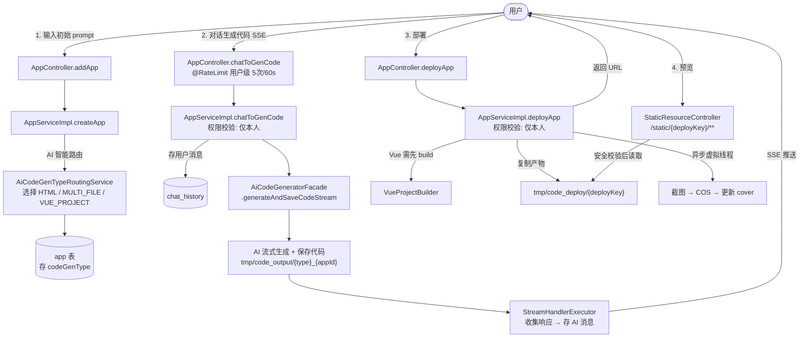
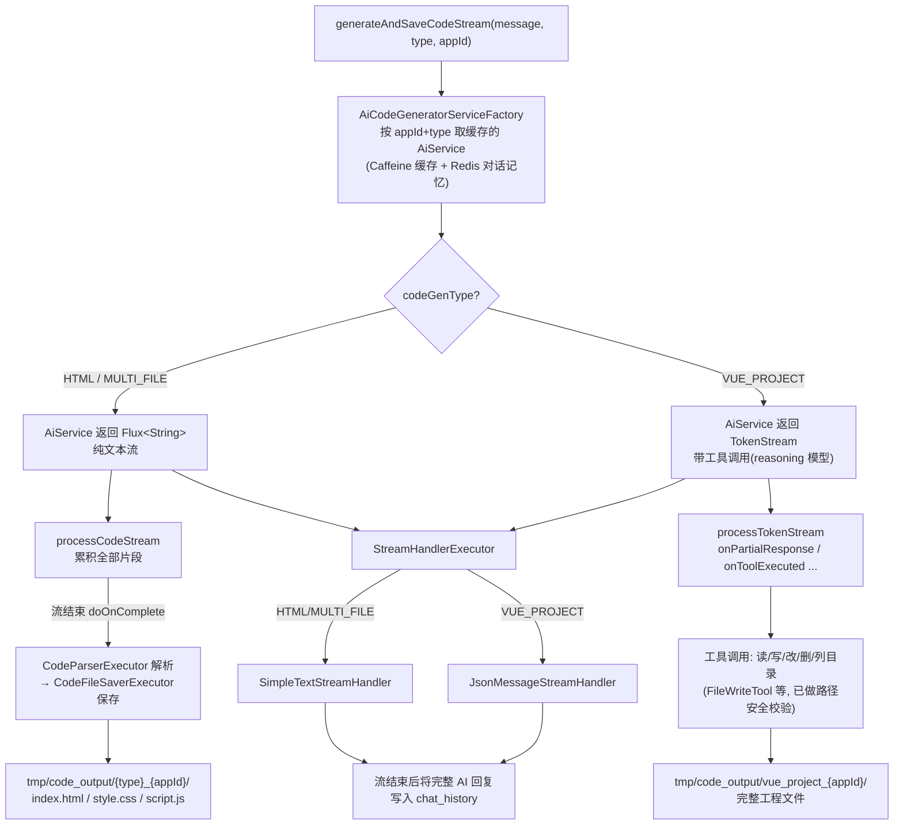
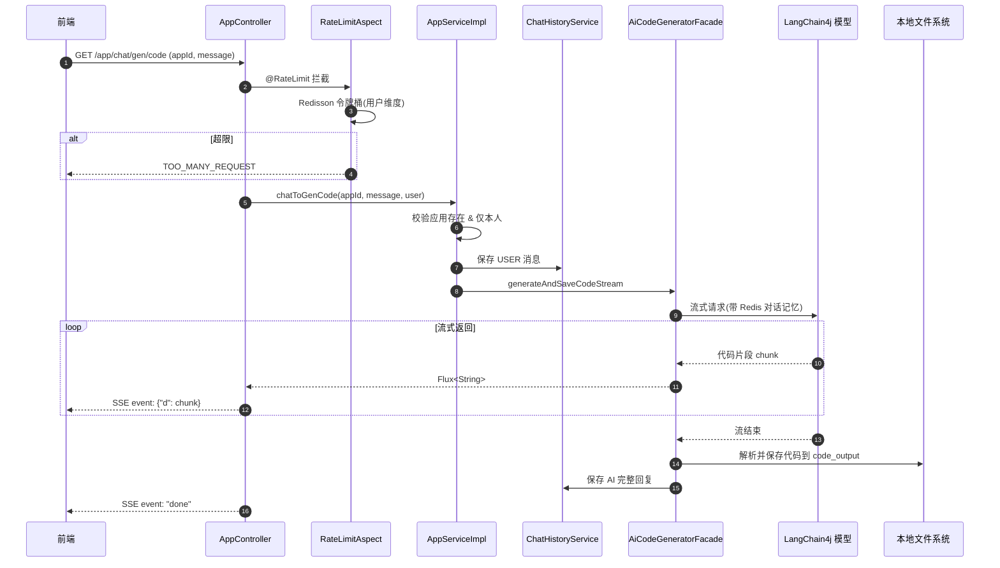

# yu-ai-father 核心链路架构文档

> 本文档基于项目实际代码梳理，描述 AI 代码生成平台的核心链路：**应用创建 → 对话生成代码（流式）→ 部署 → 预览**。

## 一、端到端核心链路（总览）

## 二、对话生成代码（核心链路，按生成类型分支）

系统最核心的部分。`AiCodeGeneratorFacade` 根据 `codeGenType` 走两条不同的流式技术路线：

- **HTML / MULTI_FILE**：模型返回纯文本 `Flux<String>`，累积后解析保存；
- **VUE_PROJECT**：使用推理模型 + 工具调用，返回 `TokenStream`，AI 通过文件工具直接读写工程文件。

## 三、SSE 请求时序图（一次完整对话）

## 四、关键链路要点

| 环节 | 关键类 | 说明 |
|------|--------|------|
| 类型路由 | `AiCodeGenTypeRoutingService` | 创建应用时 AI 自动判定生成 HTML / 多文件 / Vue 工程 |
| 服务实例管理 | `AiCodeGeneratorServiceFactory` | 按 `appId+type` 缓存 AiService（Caffeine），对话记忆存 Redis |
| 生成门面 | `AiCodeGeneratorFacade` | 统一入口，分流 `Flux<String>`（HTML/多文件）与 `TokenStream`（Vue+工具调用）|
| 流式落库 | `StreamHandlerExecutor` | 边推送边收集，流结束后把 AI 回复写入 `chat_history` |
| 代码保存 | `CodeParserExecutor` / `CodeFileSaverExecutor` | 解析模型输出 → 写入 `tmp/code_output/{type}_{appId}` |
| 部署 | `AppServiceImpl.deployApp` + `VueProjectBuilder` | Vue 先 `npm build`，产物复制到 `tmp/code_deploy/{deployKey}` |
| 预览 | `StaticResourceController` | 通过 `deployKey` 访问部署产物（已加路径遍历防护）|
| 异步增强 | 虚拟线程 + `ScreenshotService` + `CosManager` | 部署后异步截图上传 COS，回填应用封面 |

## 五、本地目录约定

| 用途 | 路径（相对进程工作目录） | 定义位置 |
|------|------------------------|---------|
| 代码生成输出 | `tmp/code_output/{type}_{appId}` | `AppConstant.CODE_OUTPUT_ROOT_DIR` |
| 部署产物 | `tmp/code_deploy/{deployKey}` | `AppConstant.CODE_DEPLOY_ROOT_DIR` |
| 部署访问域名 | `http://localhost` | `AppConstant.CODE_DEPLOY_HOST` |
